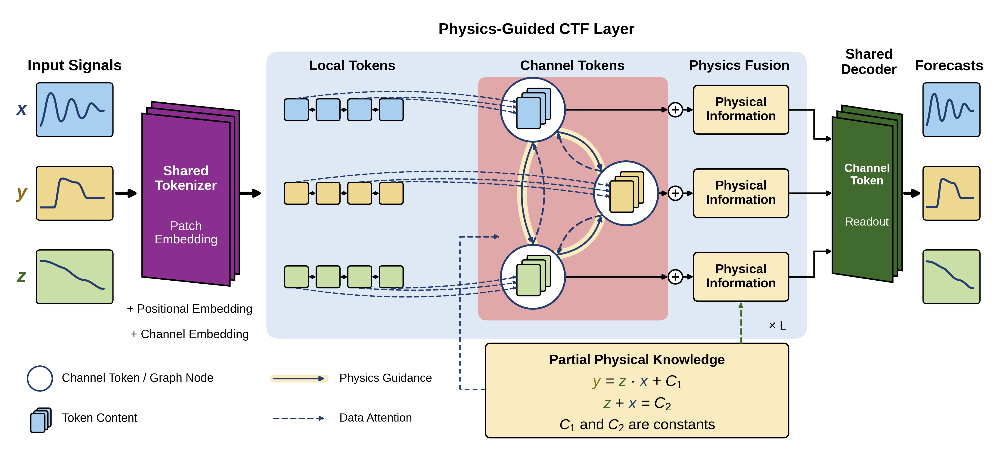
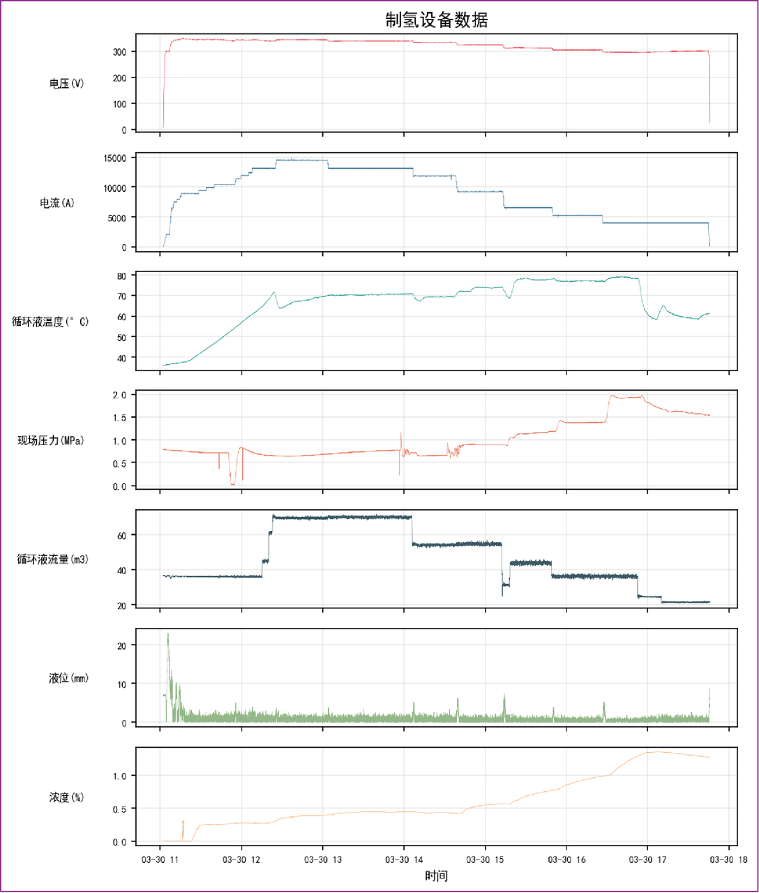
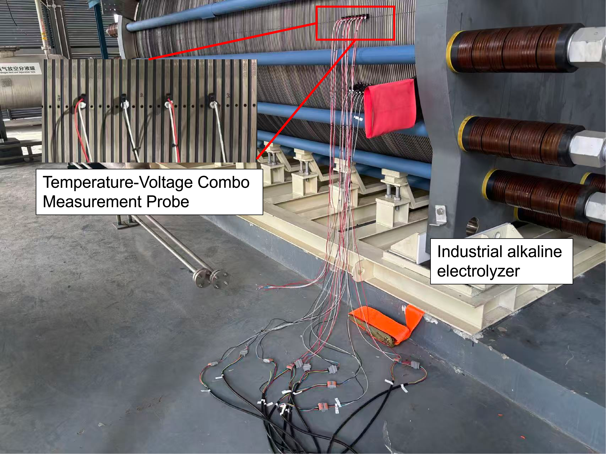
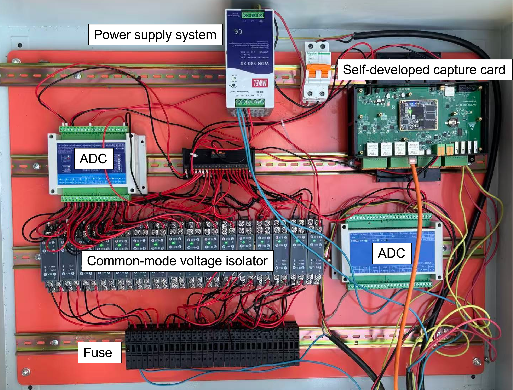
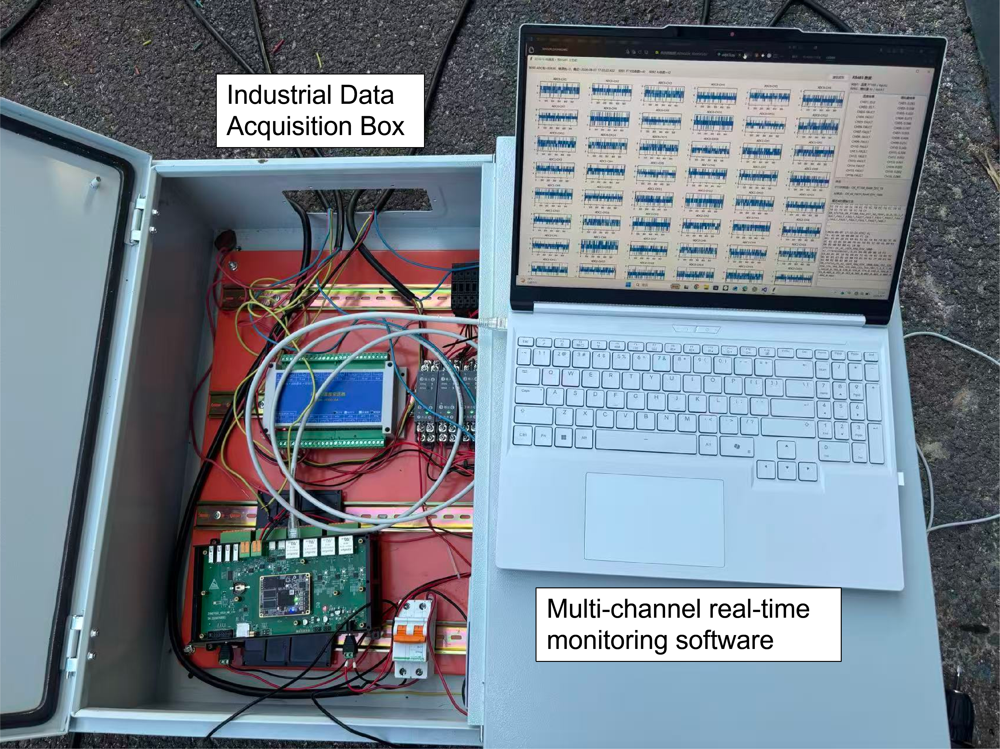
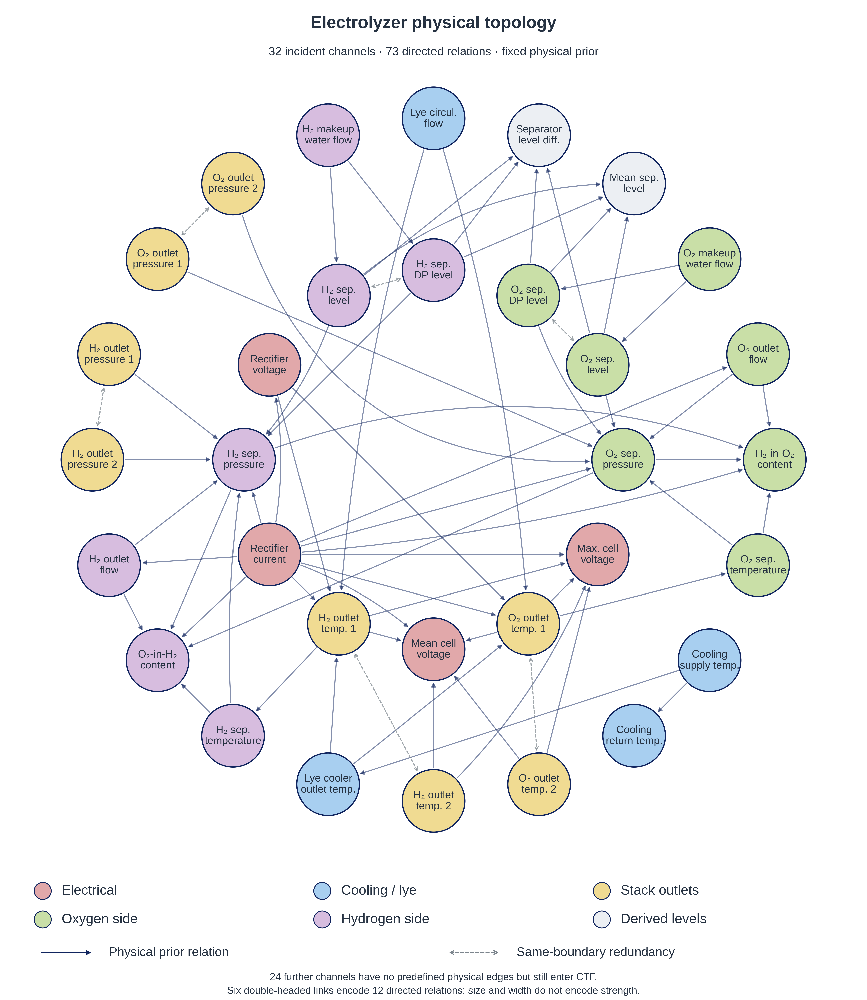
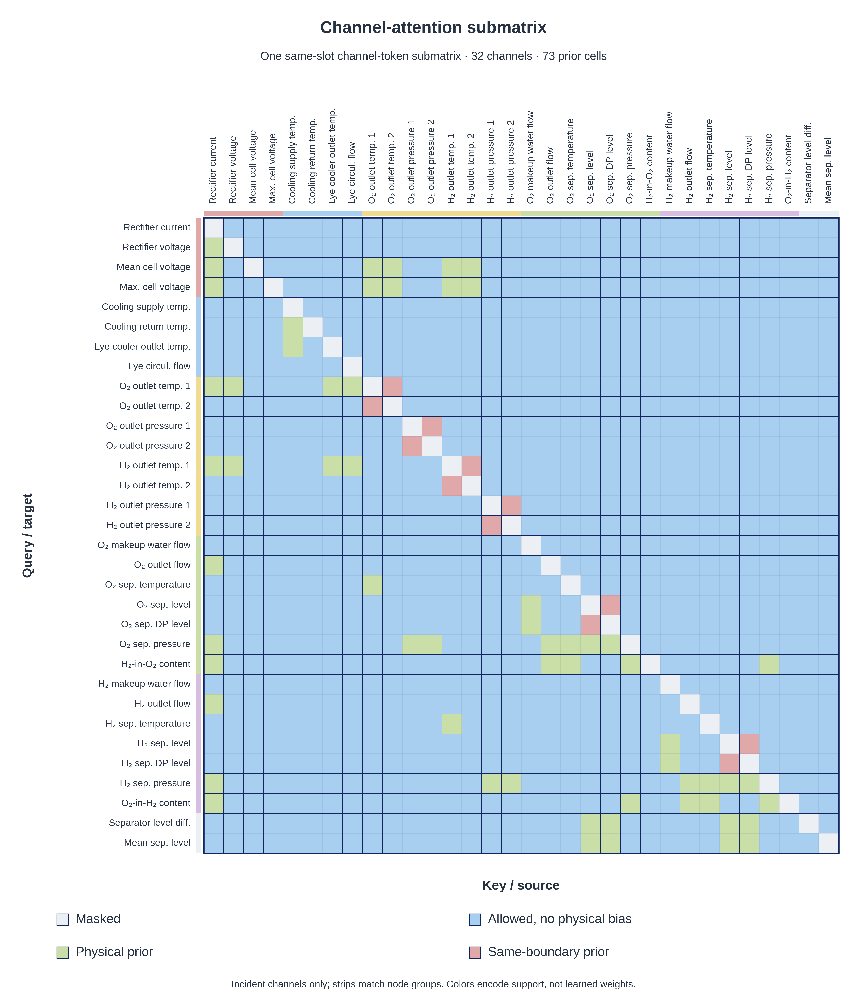
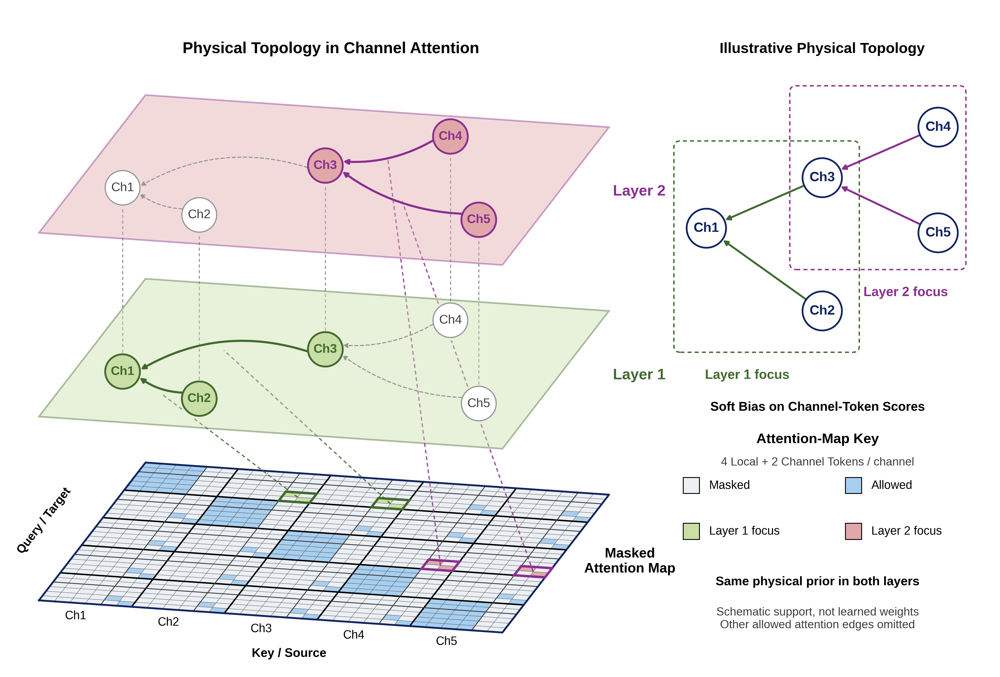
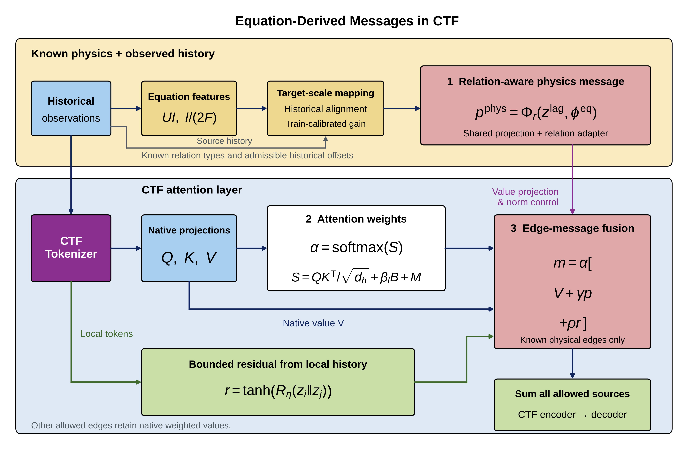
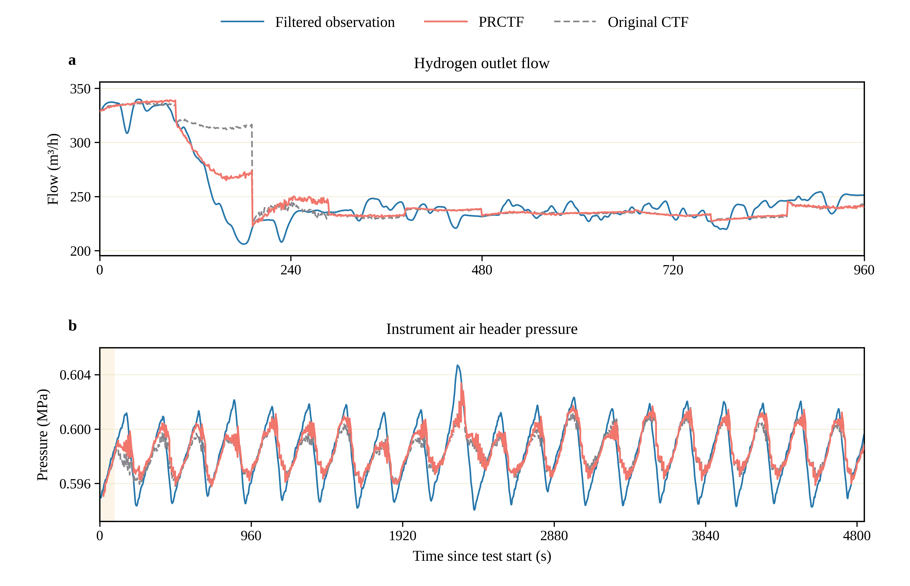

# PhysicsRelationCTF (PRCTF)

**English** | [简体中文](README_zh-CN.md)

## Physics-Guided Forecasting for Electrolyzer Monitoring and Fault Early-Warning Support

**Fault early warning in complex physical systems requires information about how operating conditions may evolve.** In hydrogen-production equipment, measurements of current, voltage, temperature, pressure, flow and gas composition describe the present operating state. Forecasting their future trajectories can provide advance information for subsequent anomaly assessment, fault early warning and operating decisions.

Reliable forecasting is difficult because these variables interact through electrochemical, thermal, fluid and control processes. Researchers often know some physical relationships, but lack the equipment parameters, measurement boundaries and dynamic equations needed for a complete mechanistic model. The central question is therefore: **how can a forecasting model use the physical knowledge that is available, while learning the dynamics that remain unknown?**

**PhysicsRelationCTF (PRCTF)** addresses this question by enhancing **ChannelTokenFormer (CTF)** at two levels of attention. Physical topology guides **which channels exchange information**; equation-derived messages provide **what the known relationships can calculate**. Data-driven attention and a lightweight residual branch learn unknown dependencies and unmodeled effects.

**Application workflow:** multisensor monitoring → **PRCTF forecasts future measurements** → downstream anomaly assessment and fault early warning.

The industrial model uses **96 seconds of history to forecast the next 96 seconds across 56 monitoring channels**. The experiments evaluate this forecasting stage. Fault-warning accuracy and warning lead time require a separate downstream evaluation.

<p align="center">
  
</p>

*Model overview, corresponding to the method illustrated in the paper's Fig. 3. The two physical interfaces operate inside attention; they do not form a separate future-curve correction or replace the native channel tokens.*

> **Archived forecasting results:** on the industrial dataset, three-seed mean normalized MSE decreases from **0.10901 to 0.10858** versus Original CTF, a **0.393%** reduction. The largest paired-seed reduction is **1.275%**. LBNL and Tennessee Eastman Process (TEP) simulations provide additional checks using physical knowledge specific to each system.

This repository provides the model implementation, physical relationship configurations, archived experiment records and figures. The sections below connect the engineering motivation to the physical modeling, attention design, evidence and reproduction steps. The manuscript PDF, industrial numerical data and trained weights remain private.

### Navigation

- [1. From fault early warning to sensor forecasting](#problem)
  - [Hardware and software platform](#hardware)
- [2. From physical equations to usable prior information](#physics)
- [3. Model architecture and information injection](#architecture)
- [4. Experiments and paper results](#results)
- [5. Installation and quick verification](#quick-start)
- [6. Public-data preparation and training](#reproduce)
- [7. Code and experiment map](#code-map)
- [8. Released figures and paper correspondence](#figures)
- [9. Scope and limitations](#limits)
- [10. Attribution, licence and citation](#citation)

<a id="problem"></a>
## 1. From fault early warning to sensor forecasting

### 1.1 Why forecast monitoring variables?

Monitoring tells operators what the equipment is doing now. Forecasting adds an estimate of what its measured operating state may do next. For an alkaline electrolyzer, predicted temperature, pressure, flow and gas-composition trends can supply advance information to a downstream warning system.

The project separates this application into three connected stages:

| Stage | Purpose | Role in this project |
|---|---|---|
| Multisensor monitoring | Record the equipment's measured operating state. | Industrial monitoring records supply the forecasting data; a separately developed acquisition platform is shown below. |
| Future-trajectory forecasting | Estimate upcoming changes across process variables. | PRCTF performs the 56-channel, 96-second forecasting task evaluated in the experiments. |
| Anomaly assessment and early warning | Combine forecasts with application-specific limits, residuals or operating rules. | Downstream use of the forecasts; warning performance is not measured by the reported forecasting errors. |

<p align="center">
  
</p>

*Industrial measurement example. This is an approved finished image, not a release of the underlying numerical records.*

### 1.2 Why use physics-guided AI for this forecasting task?

The measurements reflect coupled electrical, electrochemical, gas–liquid, circulation, cooling and control processes. A purely data-driven forecaster learns useful statistical dependencies, but does not explicitly distinguish relationships supported by process knowledge. A complete mechanistic predictor, meanwhile, would require parameters, boundary conditions and operating actions that are unavailable in these monitoring records.

Partial knowledge can still help. Current is related to electrochemical gas generation; current and voltage determine electrical power; circulation and temperature differences characterize thermal transport. PRCTF turns these relationships into **attention guidance and equation-derived messages**, while retaining the CTF forecasting path for effects that the available physics cannot describe.

The design follows one principle: **compute what the known physics supports, and learn the remaining dynamics from data**. For example, a Faradaic generation reference is physically informative, but its relationship to a downstream flow-meter reading still involves unknown equipment gains, inventories and transport responses.

<a id="hardware"></a>
### 1.3 Hardware and software platform

To connect measurement acquisition with forecasting applications, the project also includes an engineering platform comprising in-house temperature-voltage measurement probes, a data acquisition (DAQ) box and multichannel monitoring software.

The hardware supports measurement acquisition. When connected to a host computer, the monitoring software can process compatible signals and run the forecasting model as part of a real-time monitoring and warning workflow. Model inference runs on the host computer.

> **Data provenance:** The industrial records used for the paper's training, validation and testing were **not collected using the hardware shown below**. These photographs illustrate a separately developed acquisition and monitoring platform, not the origin of the reported experimental dataset.

<table>
  <tr>
    <td width="50%" valign="top">
      <a href="figures/hardware/电解槽测量图.png"></a>
      <br><strong>Industrial electrolyzer and temperature-voltage measurement probes.</strong> The inset highlights probe installation on the electrolyzer stack.
    </td>
    <td width="50%" valign="top">
      <a href="figures/hardware/电解槽测量箱.png"></a>
      <br><strong>In-house data acquisition box.</strong> The enclosure integrates the acquisition board, ADC modules, signal isolation, power supply and protection components.
    </td>
  </tr>
</table>

<p align="center">
  <a href="figures/hardware/软硬件结合.png"></a>
</p>

*Computer-connected acquisition and multichannel monitoring. The software displays acquired signals and provides the host-side platform for integrating forecasting and warning functions.*

Deployment requires measurements compatible with the checkpoint's channel definitions, units, sampling rate, normalization and physical relationships. The pictured temperature-voltage probes alone do not establish availability of all 56 channels required by the archived industrial model.

The photographs document the acquisition and monitoring platform; the experiment tables evaluate forecasting accuracy. The public materials include these photographs and descriptions, while hardware designs, acquisition firmware and monitoring-software source code remain outside this release.

<a id="physics"></a>
## 2. From physical equations to usable prior information

Using partial physics requires answering two questions: **which measurements have a known physical relationship, and what useful information can that relationship provide?** The first yields a sparse directed graph; the second yields features computed from historical observations. The electrolyzer example below organizes measurements by process meaning and available equations.

| Process knowledge | Available relationship or feature | How it is used |
|---|---|---|
| Electrical input | `P = UI` | Relates current/voltage to electrical input and thermal-state prediction. |
| Electrochemical polarization | Cell voltage depends on reversible voltage, overpotentials and ohmic drop. | Supports current/temperature-to-voltage relationships; the complete polarization voltage is not solved. |
| Faradaic generation | Ideal per-cell references `I/(2F)` and `I/(4F)`. | Supplies gas-generation reference features, not calibrated equipment outlet flows. |
| Electrolyte heat transport | Circulation flow × outlet-to-inlet temperature difference. | Provides heat-transport proxies without pretending unknown material properties are known. |
| Cooling | Cooling-water return-to-supply temperature difference. | Supplies a measured thermal reference. |
| Gas/liquid inventory and impurities | Local balance relationships, separator pressures, levels, make-up flows and pressure difference. | Supports selected relationships and available proxies; the full inventory and impurity dynamics remain unresolved. |
| Same-boundary measurements | Paired measurements or derived signals with documented common boundaries. | Provides selected consistency relationships, not an all-to-all same-unit graph. |

### 2.1 Step one: represent which channels are related

The frozen industrial graph contains **56 channels, 73 directed relationships and 9 relation types**. The node illustration displays the **32 incident channels**; channels without a prior edge are still retained in the forecasting task and native data attention.

The nine types are electrical, electrochemical, gas generation, gas transport, thermal, hydraulic, gas inventory, impurity and same-boundary consistency. Only direct supported relationships are included; no correlation graph, manually expanded `A²/A³` or standalone GCN encoder defines the selected model.

<p align="center">
  
</p>

<p align="center">
  
</p>

*The node graph and matrix express the same fixed prior, as in the paper's Fig. 2. Rows receive information; columns supply it. These are prior-support diagrams, not learned attention heatmaps or identified causal effects.*

### 2.2 Step two: represent what the relationships can calculate

Known functions are applied to **historical measurements only**. For example, a 96-point current history yields a 96-point ideal hydrogen-generation reference `I/(2F)`. Missing cell count, Faradaic efficiency, gas inventories and transport conditions prevent interpreting that reference as the equipment's measured outlet flow.

Equation features are mapped to the target representation using training-only observation calibration, admissible historical alignment and a lightweight relation adapter. For the Faraday example, constant rescaling does not create an independent measurement: the contribution is its physically motivated representation and routing into the target channel, not a complete generation-to-outflow solution.

Together, the graph and equation features provide **structural guidance and numerical reference content**. The data-driven path continues to learn dependencies and responses not described by these partial relationships.

Exact sources, relation types and limits are retained in [industrial graph.json](configs/industrial/graph.json) and the [equation implementation](workspace/PhysicsRelationCTF/physics.py). LBNL and TEP use their own [graphs](configs/lbnl/graph.json), [equations and graph definitions](configs/tep/graph.json), rather than copying electrolyzer physics.

<a id="architecture"></a>
## 3. Model architecture and information injection

The two knowledge sources enter the same CTF forecasting backbone through complementary interfaces. **Topology changes the preference for reading a source; equation messages enrich the content read from that source.** The original data-driven path remains available to learn dependencies beyond the known physical relationships.

### 3.1 Preserve the original CTF prediction path

PRCTF retains CTF's patch embedding, learnable channel tokens, masked attention and **channel-token decoder**:

1. Normalize each channel's history and embed complete patches as local tokens.
2. Introduce the original learnable channel tokens.
3. Allow local tokens to read same-channel local tokens; channel tokens read their local history and other channels' channel tokens at matching slots.
4. Decode the updated channel tokens into the multistep forecast.

The industrial configuration has 4 observed patches of length 24 and 2 channel tokens per channel. It does not use local-token decoding, synthetic padding or the abandoned `GCN → replacement channel token` path.

### 3.2 Structural interface: topology-guided attention bias

The adjacency convention is:

```math
A^{\mathrm{phys}}_{ij}=1 \quad\Longleftrightarrow\quad j\rightarrow i.
```

A lightweight network modulates the strength of existing physical edges using historical context. In the industrial implementation:

```math
b_{ij}(X)=1+\tfrac12\tanh\!\left(g_\phi(\xi_{ij}(X))+a_{r_{ij}}\right).
```

Here `xi_ij` summarizes the relevant histories, and `a_r` is a learnable baseline for the relationship type. Modulation is bounded within `(0.5, 1.5)` and does not add new physical edges.

The bias is lifted to **same-slot Channel–Channel positions** and added to the native attention scores:

```math
\alpha^{(l)}=\mathrm{Softmax}_{\mathrm{key}}\left(
\frac{Q^{(l)}K^{(l)\top}}{\sqrt{d_h}}+\beta_l B(X_{\mathrm{hist}})+M
\right).
```

`M` remains the original CTF mask. A positive bias favors an information source; it is not a claim that the physical response has a positive sign. Other originally allowed interactions remain data-driven.

<p align="center">
  
</p>

*Topology-to-attention mapping, corresponding to the paper's Fig. 4. Both layers share the same prior; highlighted paths illustrate successive message propagation. This has the aggregation interpretation of a graph network, but is not algebraically identical to classical GCN.*

### 3.3 Content interface: equation-derived messages

After target-scale preprocessing and historical alignment, relation-aware message construction is summarized by:

```math
p^{\mathrm{phys}}_{ij}
=E_P(\phi^{\mathrm{eq}}_{ij})
+\mathrm{Adapt}_{r_{ij}}\left(
E_P(\phi^{\mathrm{eq}}_{ij})\Vert E_P(z^{\mathrm{lag}}_{j\to i})
\right).
```

`phi_eq` is the preprocessed equation feature, `z_lag` is aligned source history, and `E_P` reuses the CTF patch projection. The adapter combines **equation and source-history encodings**; it does not simply append a reference flow to the initial target-flow token.

<p align="center">
  
</p>

*Equation-message construction and fusion, corresponding to the paper's Fig. 5. Historical observations supply equation features; projection and lightweight adaptation produce messages compatible with CTF.*

### 3.4 Fuse physics and data within attention

The industrial aggregation can be summarized as:

```math
O_i^{(l)}=O_{\mathrm{data},i}^{(l)}
+\sum_{j:\,j\to i\in\mathcal E}\widetilde\alpha_{ij}^{(l)}
\left(\gamma_l\overline p_{ij}^{(l)}+\rho_l\overline r_{ij}^{(l)}\right).
```

The physical messages reuse the topology-guided attention weights. A small residual network uses source/target local histories to compensate for unmodeled effects. Native value aggregation remains active for all originally allowed sources. The result continues through the unchanged CTF encoder and channel-token decoder; no separate predicted correction curve is added afterward.

Learnable `beta`, `gamma` and `rho` control topology guidance, equation injection and residual compensation. Industrial parameters use nonnegative/bounded parameterizations and message-norm control. Explicitly disabling **all three** enhancement paths recovers the paired Original CTF forward path; setting `beta = 0` alone does not.

The executable industrial snapshot uses `representation="centered"`. Public instances additionally use their documented target-level representations, validity checks and conditional-neighbor aggregation. Consult [configuration snapshots](configs) and the [source map](#code-map) for actual reproduction details.

<a id="results"></a>
## 4. Experiments and paper results

The experiments test whether partial physical knowledge improves **multivariate forecasting accuracy**, and whether topology guidance and equation messages contribute to that improvement. Industrial electrolyzer records provide the application case; LBNL and TEP simulations test the same integration approach with different physical relationships. All tables below retain the archived paper-experiment protocol and values.

### 4.1 Fixed evaluation protocol

The full-data experiments use **seeds 42, 43 and 44**. CTF–PRCTF pairs share data splits, observations, horizons, targets, preprocessing, common backbone initialization and training policy. Train statistics define normalization and observation calibration; validation error selects checkpoints.

| Dataset and role | Sampling | Inputs / targets | History → forecast | Patch |
|---|---|---:|---:|---:|
| Industrial electrolyzer: application evaluation | 1 s | 56 / 56 | 96 → 96 points | 24 |
| LBNL chiller: simulation-based module validation | 1 min | 73 / 58 | 96 → 96 points | 24 |
| TEP: simulation-based module validation | 3 min | 52 / 52 | 20 → 20 points | 5 |

The industrial horizon is a **minute-scale task setting**, not an identified physical time constant or a demonstrated optimal horizon. The public tasks use different sampling intervals and therefore different physical forecast durations. Instances are modeled and trained separately; this is not zero-shot transfer.

LBNL uses the fault-free EnergyPlus–Modelica chiller-plant simulation, with water temperatures, flows, power, control and weather variables. TEP uses fault-free chemical-process trajectories with 41 measured and 11 manipulated variables. Public dataset sources and fixed subsets are listed [below](#reproduce).

### 4.2 Simulation-based validation of the two physical modules

The paper's Table 6 compares the full model with **separately trained** controls disabling one interface. Values below are three-seed means; extra digits retain the nearly tied TEP result.

| Dataset | Configuration | Normalized MSE | Normalized MAE |
|---|---|---:|---:|
| LBNL | **Full PRCTF** | **0.00255002** | **0.00456146** |
| LBNL | w/o attention bias | 0.00255095 | 0.00460462 |
| LBNL | w/o equation messages | 0.00257068 | 0.00464841 |
| TEP | Full PRCTF | 0.82118871 | 0.70023528 |
| TEP | **w/o attention bias** | **0.82118710** | **0.70023496** |
| TEP | w/o equation messages | 0.82708094 | 0.70287048 |

- **Attention bias:** `no_bias` fixes `beta = 0` but retains equation and residual messages. Its removal slightly worsens LBNL; TEP is effectively unchanged and marginally favors the ablation.
- **Equation messages:** `no_equation` fixes `gamma = 0`. Full PRCTF reduces mean MSE by **0.804% on LBNL and 0.712% on TEP** relative to this control.
- The numerical equation-message interface has the more consistent contribution. These results do not establish that both interfaces independently improve every system.

Source: [complete ablation and input-control records](results/ablation_and_input_per_seed.csv). Industrial component records are retained there as supplementary evidence.

### 4.3 Paired CTF–PRCTF comparison

The paper's Table 7 reports the following three-seed means. Lower is better; normalization and target definitions are specific to each task.

| Dataset | Model | Normalized MSE | Normalized MAE |
|---|---|---:|---:|
| Industrial electrolyzer | Original CTF | 0.10901009 | 0.10809476 |
| Industrial electrolyzer | **PRCTF** | **0.10858198** | **0.10775839** |
| LBNL | Original CTF | 0.00257001 | 0.00462957 |
| LBNL | **PRCTF** | **0.00255002** | **0.00456146** |
| TEP | Original CTF | 0.82707916 | 0.70286754 |
| TEP | **PRCTF** | **0.82118871** | **0.70023528** |

Reduction is `100 × (CTF error − PRCTF error) / CTF error`; **positive means a lower error**.

| Dataset | Mean MSE reduction | Mean MAE reduction | Largest paired-seed MSE reduction | MSE wins |
|---|---:|---:|---:|---:|
| Industrial electrolyzer | **0.393%** | 0.311% | 1.275% | 2 / 3 |
| LBNL | **0.778%** | 1.471% | 2.588% | 2 / 3 |
| TEP | **0.712%** | 0.375% | 0.760% | 3 / 3 |

The result supports small mean gains over the same CTF backbone after system-specific physical modeling. It does not establish universal superiority, a monotonic few-shot advantage or significance from three seeds. A best-seed reduction is not an average reduction.

<details>
<summary>All nine paired-seed MSE results, including regressions</summary>

| Dataset | Seed | CTF MSE | PRCTF MSE | Reduction |
|---|---:|---:|---:|---:|
| Industrial | 42 | 0.10912231 | 0.10773149 | +1.275% |
| Industrial | 43 | 0.10858620 | 0.10884467 | −0.238% |
| Industrial | 44 | 0.10932176 | 0.10916977 | +0.139% |
| LBNL | 42 | 0.00258835 | 0.00253391 | +2.103% |
| LBNL | 43 | 0.00253232 | 0.00259382 | −2.428% |
| LBNL | 44 | 0.00258936 | 0.00252234 | +2.588% |
| TEP | 42 | 0.82692956 | 0.82170499 | +0.632% |
| TEP | 43 | 0.82592958 | 0.81965383 | +0.760% |
| TEP | 44 | 0.82837836 | 0.82220730 | +0.745% |

Per-pair MAE is also available in [ctf_prctf_paired.csv](results/ctf_prctf_paired.csv). Standard deviations and metric-specific minima are retained in [method_comparison_summary.csv](results/method_comparison_summary.csv).

</details>

### 4.4 Industrial forecasting comparison

Following the paper's Table 8, the application comparison contains **Original CTF, MTGNN, PatchTST, a forecasting adaptation of PhyGNN, and PRCTF**. Mean averages the three fixed seeds; Best is the minimum of the corresponding metric across those runs and need not come from the same seed for MSE and MAE.

| Model | MSE Mean | MSE Best | MAE Mean | MAE Best | Recorded training time (s) |
|---|---:|---:|---:|---:|---:|
| Original CTF | 0.10901 | 0.10859 | 0.10809 | 0.10796 | 514.1 |
| MTGNN | 0.11012 | 0.10974 | 0.10800 | 0.10701 | 182.2 |
| PatchTST | 0.11145 | 0.11076 | 0.11124 | 0.11022 | 89.2 |
| PhyGNN adapted | 0.14649 | 0.14365 | 0.18030 | 0.17610 | **69.8** |
| **PRCTF** | **0.10858** | **0.10773** | **0.10776** | **0.10695** | 615.2 |

Within these five evaluated configurations, PRCTF has the lowest mean and best MSE/MAE. Mean MSE is **0.393% lower than CTF, 1.398% lower than MTGNN and 2.571% lower than PatchTST**. It is not the fastest model: the timing column contains archived average training durations, not a parameter-matched or controlled hardware-efficiency benchmark.

PhyGNN retains the publicly available graph aggregation module with an added forecast head; this is an adaptation, not a full reproduction of its original task. Comparator expansion followed a seed-42 pilot, so the ranking is an exploratory application comparison. See [adaptation disclosures](workspace/PhysicsRelationCTF/runs/physics_ai_comparison_v1/UPSTREAM.md).

Sources: [per-seed methods](results/method_comparison_per_seed.csv) and [mean/std/best/time summary](results/method_comparison_summary.csv).

### 4.5 Industrial prediction examples

<p align="center">
  
</p>

*The two channels illustrated in the paper's Fig. 6: instrument-air header field pressure and hydrogen-cooler outlet temperature. Blue denotes filtered observations; red is PRCTF; gray dashed is Original CTF.*

These curves come from a **separate single-seed low-pass experiment**, with Train/Validation/Test data causally filtered using a second-order Butterworth low-pass filter at 0.05 Hz. Successive 96-step forecasts are stitched across the complete test segment; the plot is not one long open-loop forecast. This filtered illustration does **not** generate the raw-data three-seed main results above. Numerical table evidence and curve examples must keep their respective preprocessing definitions.

### 4.6 Complete historical evidence remains available

The repository retains **63 records: 7 methods × 3 datasets × 3 seeds**, including EquationInput-CTF and PG-Reg-CTF as additional custom controls. These are not included among the five primary application comparators above, nor described as separately published architectures or a standard full-system PINN.

PRCTF does not outperform every retained method on every dataset: MTGNN and PatchTST have lower mean MSE on LBNL, while EquationInput-CTF and PG-Reg-CTF have lower mean MSE on TEP. Those results remain in the [complete summary](results/method_comparison_summary.csv) and [results notes](results/README.md), rather than being removed to match the paper's narrower comparison scope.

<a id="quick-start"></a>
## 5. Installation and quick verification

### 5.1 Environment and pinned CTF source

Use Python 3.10 or a compatible environment. Install an appropriate CPU/CUDA PyTorch build separately; the study APIs require **PyTorch ≥ 2.7**. The environment snapshot records packaging-time software, not a guarantee of the original training environment.

```bash
git clone https://github.com/field-mx/PhysicsRelationCTF.git
cd PhysicsRelationCTF

python -m venv .venv
source .venv/bin/activate

# Install a suitable PyTorch build first, then:
pip install -r requirements-model.txt

# Review THIRD_PARTY_NOTICES.md before retrieving upstream code.
python scripts/fetch_upstreams.py --ctf
```

CTF is fetched at `b1c100effb9c27cd25de07e91de7f9005d18d5e7`, not bundled. The fetcher refuses to overwrite an existing upstream directory. Optional comparator retrieval: `python scripts/fetch_upstreams.py --comparators`, after reviewing its terms.

### 5.2 Check files, tables and synthetic forwards

```bash
# Verify unchanged code, configs, results, figures and supporting documents.
python - <<'PY'
import hashlib
import json
from pathlib import Path

root = Path.cwd()
docs = {'README.md', 'README_zh-CN.md'}
rows = json.loads((root / 'manifests/files.json').read_text())['files']
checked = 0
for row in rows:
    if row['path'] in docs:
        continue
    path = root / row['path']
    assert path.is_file() and not path.is_symlink(), row['path']
    assert path.stat().st_size == row['bytes'], row['path']
    assert hashlib.sha256(path.read_bytes()).hexdigest() == row['sha256'], row['path']
    checked += 1
print(f'Verified {checked} unchanged non-README release files.')
PY

python scripts/summarize_results.py

# Separate processes, after dependencies and CTF are available.
python scripts/smoke_test.py --dataset industrial
python scripts/smoke_test.py --dataset lbnl
python scripts/smoke_test.py --dataset tep
```

The release manifest `manifests/files.json` retains the original packaging hashes. Documentation revisions do not rewrite it: running `scripts/verify_package.py` directly reports a README snapshot mismatch. The check above excludes only these two README files and still verifies every other original manifest entry. The newly added hardware photographs are outside that historical snapshot and are listed in Section 1.3. Result verification does not retrain or reevaluate models.

Smoke tests use paired common backbone weights, check finite outputs, explicitly disable all physical interfaces and compare against CTF. Recorded CPU packaging checks had maximum absolute differences of **0.0** for all three tasks. These are synthetic execution/equivalence checks, not accuracy tests. Industrial synthetic unit statistics are labeled and never substituted for industrial training data.

Append `--device cuda:0` for a GPU, or supply an existing pinned checkout with `--ctf-root /path/to/ChannelTokenFormer`.

<a id="reproduce"></a>
## 6. Public-data preparation and training

### 6.1 Obtain the correct public subsets

| Dataset | Source | Subset |
|---|---|---|
| LBNL | [Official chiller-plant page](https://faultdetection.lbl.gov/dataset/simulated-chiller-plant/) · [collection DOI](https://doi.org/10.25984/1881324) | Fault-free `ChillerPlant.csv`, not all fault scenarios. |
| TEP | [Harvard Dataverse](https://doi.org/10.7910/DVN/6C3JR1) · [retrieval mirror](https://www.kaggle.com/datasets/averkij/tennessee-eastman-process-simulation-dataset) | Fault-free training/testing RData files with fixed run membership. |

LBNL uses **367878 / 78831 / 78831 points** chronologically. TEP uses training-file runs **1–80 / 81–100** for Train/Validation, and testing-file runs **401–500** for Test. Raw public data are linked rather than mirrored. Citations, access conditions and provenance: [DATA_AVAILABILITY.md](DATA_AVAILABILITY.md).

```bash
pip install -r requirements-data.txt
python scripts/prepare_public_data.py --dataset lbnl
python scripts/prepare_public_data.py --dataset tep
```

Preparation verifies source hashes and task membership; it does not train. Download/authentication conditions may change. A fresh bulk acquisition was not rerun during packaging, so these entry points are not advertised as a fully retested download service.

### 6.2 Train a controlled pair

```bash
# LBNL: 96 observed points -> 96 future points.
python scripts/train_public.py --dataset lbnl --kind CTF --seed 42 --device cuda:0 --out outputs/lbnl_seed42
python scripts/train_public.py --dataset lbnl --kind Physics --seed 42 --device cuda:0 --out outputs/lbnl_seed42

# TEP: 20 observed points -> 20 future points.
python scripts/train_public.py --dataset tep --kind CTF --seed 42 --device cuda:0 --out outputs/tep_seed42
python scripts/train_public.py --dataset tep --kind Physics --seed 42 --device cuda:0 --out outputs/tep_seed42
```

`Physics` selects PRCTF. Repeat with **43 and 44**, not a search for favorable seeds. This launcher trains/selects on **Train/Validation only**, without automatic Test evaluation. Use fresh output locations; published evidence directories cannot be training outputs.

| Instance | Initial beta / gamma / rho | Learning rate | Maximum epochs | Batch size |
|---|---|---:|---:|---:|
| Industrial | 0.05 / 0.75 / 0.001 | 0.0001 | 16 | 32 |
| LBNL | 0.05 / 0.10 / 0.001 | 0.0003 | 32 | 32 |
| TEP | 0.05 / 0.75 / 0.001 | 0.0003 | 16 | 64 |

All three selected CTF backbones use hidden dimension 256, FFN dimension 1024, 2 encoder layers, 8 heads, 2 channel tokens per channel and dropout 0.1. Configuration snapshots are **not trained weights**. Injection strengths remain learnable during training.

**Final evaluation is separate:** lock both validation-selected checkpoints before using archived evaluation functions. The portable launcher does not promise one-command, bit-identical reproduction of published errors. See [REPRODUCIBILITY.md](REPRODUCIBILITY.md) for the contract and historical dependencies.

### 6.3 Industrial reproduction boundary

Industrial observations, fitted scaling/gain statistics, weights and numerical figure-source series are not distributed. Graphs, schema, source, metrics and approved images support inspection, but industrial accuracy cannot be regenerated without authorized access to the original records. No unsupported promise of request-based access is made.

<a id="code-map"></a>
## 7. Code and experiment map

```text
.
├── README.md / README_zh-CN.md     # English / Chinese documentation
├── DATA_AVAILABILITY.md           # Sources, subsets and access boundaries
├── REPRODUCIBILITY.md             # Training/evaluation contract
├── configs/{industrial,lbnl,tep}/  # Selected model/physical-graph snapshots
├── results/                      # Complete comparison/control tables
├── figures/                      # Approved finished PNG/PDF figures
├── scripts/                      # Portable construction, preparation and checks
├── manifests/                    # File hashes and provenance
└── workspace/
    ├── PhysicsRelationCTF/        # Selected model/experiment source and evidence
    ├── PhysicsGuidedCTF/          # CTF channel-token wrapper and data helpers
    └── GNN_Transformer/           # Required historical topology definitions
```

The sibling `workspace/` layout preserves relative imports; it is not the full lab workspace. `GNN_Transformer/` does not mean the released model uses the old GCN encoder.

| What to inspect | Entry point |
|---|---|
| Portable paired construction | [scripts/model_factory.py](scripts/model_factory.py) |
| Industrial bias, messages, aggregation and residual | [relation_model.py](workspace/PhysicsRelationCTF/relation_model.py) |
| Industrial equation functions and relation/offset definitions | [physics.py](workspace/PhysicsRelationCTF/physics.py) |
| Original channel-token readout wrapper | [PhysicsGuidedCTF/model.py](workspace/PhysicsGuidedCTF/model.py) |
| Selected LBNL message implementation | [model_v7.py](workspace/PhysicsRelationCTF/runs/publicdata_exp/optimization_v2/model_v7.py) and preserved imports |
| LBNL equations and control references | [public_physics_v4.py](workspace/PhysicsRelationCTF/runs/publicdata_exp/public_physics_v4.py) and preserved imports |
| TEP equation bank and calibration | [tep_physics.py](workspace/PhysicsRelationCTF/runs/TEP/tep_physics.py) |
| Selected TEP 20→20 adapter | [length_model.py](workspace/PhysicsRelationCTF/runs/TEP/window_search_v1/length_model.py) |
| Component/direct-input controls | [paper_minimal_v1](workspace/PhysicsRelationCTF/runs/paper_minimal_v1) |
| Industrial comparator adapters and records | [physics_ai_comparison_v1](workspace/PhysicsRelationCTF/runs/physics_ai_comparison_v1) |
| Public comparator records | [physics_ai_comparison_public_v1](workspace/PhysicsRelationCTF/runs/physics_ai_comparison_public_v1) |
| Source-to-export mapping | [manifests/source_map.json](manifests/source_map.json) |

`paper_minimal_v1` is a component-experiment folder name, not manuscript content. Some historical orchestrators require original caches, weight locks or private calibration. Use `scripts/` for supported checkpoint-free construction and public Train/Validation runs rather than assuming every archived orchestrator is standalone.

<a id="figures"></a>
## 8. Released figures and paper correspondence

The table links released model figures and the accompanying engineering-platform photographs. Hardware photographs document the setup, not an additional forecasting or fault-warning experiment. No manuscript files are added.

| Paper content | Released PNG | Released PDF |
|---|---|---|
| Fig. 2(a): industrial topology, English | [View](figures/topology/electrolyzer_topology_en.png) | [Download](figures/topology/electrolyzer_topology_en.pdf) |
| Fig. 2(b): channel-relation submatrix, English | [View](figures/topology/electrolyzer_channel_attention_en.png) | [Download](figures/topology/electrolyzer_channel_attention_en.pdf) |
| Industrial topology, Chinese | [View](figures/topology/electrolyzer_topology_zh.png) | [Download](figures/topology/electrolyzer_topology_zh.pdf) |
| Fig. 3: model overview | [View](figures/architecture/model_architecture.png) | [Download](figures/architecture/model_architecture.pdf) |
| Fig. 4: topology-to-attention mapping | [View](figures/architecture/topology_attention.png) | [Download](figures/architecture/topology_attention.pdf) |
| Fig. 5: equation-message pipeline | [View](figures/architecture/physics_message.png) | [Download](figures/architecture/physics_message.pdf) |
| Fig. 6: low-pass forecast examples | [View](figures/industrial/lowpass_test_predictions.png) | [Download](figures/industrial/lowpass_test_predictions.pdf) |
| Hardware: electrolyzer and temperature-voltage probes | [View](figures/hardware/电解槽测量图.png) | Not applicable |
| Hardware: in-house data acquisition box | [View](figures/hardware/电解槽测量箱.png) | Not applicable |
| Software: computer-connected multichannel monitoring | [View](figures/hardware/软硬件结合.png) | Not applicable |

Figure numbers identify corresponding content, not byte-identical embedded artwork in the revised PDF. The revised process/measurement schematic (Fig. 1) is not newly released in this update. See [figure notes](figures/README.md) and [asset provenance](manifests/figure_sources.json); configuration snapshots and source remain the computational reference.

<a id="limits"></a>
## 9. Scope and limitations

- **Application role:** PRCTF supplies future sensor trajectories to support downstream fault early warning. The reported MSE and MAE evaluate forecasting; they do not measure fault classification, false alarms or warning lead time.
- **Supported:** PRCTF improves mean forecasting error on the available industrial electrolyzer records and evaluated configurations; the public simulations provide numerical module-validation evidence, not proof of a universal cross-industry model or zero-shot transfer.
- **Not established:** universal superiority, zero-shot plant transfer, statistical significance from three seeds, strict conservation, causal discovery, or an advantage that must grow with data scarcity.
- **Interpretability:** relationship sources, equation calculations and insertion locations are inspectable. Attention weights and fitted observation gains are not identified causal effects or physical constants.
- **Uncertain relationships:** public instances include documented validity and historical-consistency checks, not a guarantee that every incorrect prior is detected and suppressed.
- **Development exposure:** seed 42 and fixed Test sets were observed during development. Additional seeds do not turn previously observed tests into blind evaluations.
- **Comparison:** applicable physics methods share available physical information, but architectures are not parameter-count or runtime matched. Adaptations and pilot-selection limits remain disclosed.
- **Validation:** synthetic forwards were recorded for the original package. Documentation and hardware-photo additions do not include new training, forecasting evaluation or fault-warning validation. README snapshot hashes and the historical manifest's scope are explained in Section 5.2; cross-hardware bit-identical accuracy is not promised.
- **Scarcity:** earlier few-shot and SDWPF bias-only studies did not establish a monotonic scarcity advantage; those outcomes are not presented as successful scarcity validation here.

Details: [VALIDATION.md](VALIDATION.md), [REPRODUCIBILITY.md](REPRODUCIBILITY.md), [results/README.md](results/README.md).

<a id="citation"></a>
## 10. Attribution, licence and citation

PRCTF builds on **ChannelTokenFormer**, not an original replacement backbone. Please acknowledge upstream methods and datasets when using their components:

- [ChannelTokenFormer](https://github.com/jinkwan1115/ChannelTokenFormer): CTF backbone and masked attention.
- [MTGNN](https://github.com/nnzhan/MTGNN), [PatchTST](https://github.com/yuqinie98/PatchTST), [PhyGNN](https://github.com/DiYi1999/PhyGNN): comparison implementations, subject to their terms; see [adaptation disclosures](workspace/PhysicsRelationCTF/runs/physics_ai_comparison_v1/UPSTREAM.md).
- [LBNL FDD collection](https://doi.org/10.25984/1881324): cite the collection and specific simulated-chiller subset.
- [Rieth et al., TEP simulation data, Harvard Dataverse V1](https://doi.org/10.7910/DVN/6C3JR1): public process data.

No original-code open-source licence has yet been selected; public visibility is not a blanket reuse grant. Third-party source/data retain their terms. See [LICENSE_STATUS.md](LICENSE_STATUS.md) and [THIRD_PARTY_NOTICES.md](THIRD_PARTY_NOTICES.md).

For now, cite this repository with a **fixed commit** following [CITATION.md](CITATION.md). No acceptance, article DOI or archived software DOI is asserted. Old code is preserved on [legacy-v1](https://github.com/field-mx/PhysicsRelationCTF/tree/legacy-v1); `main` uses the publication-oriented layout.
