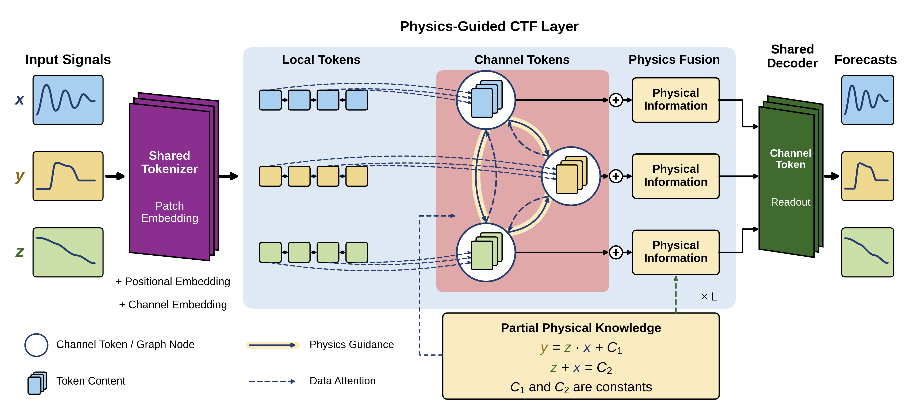
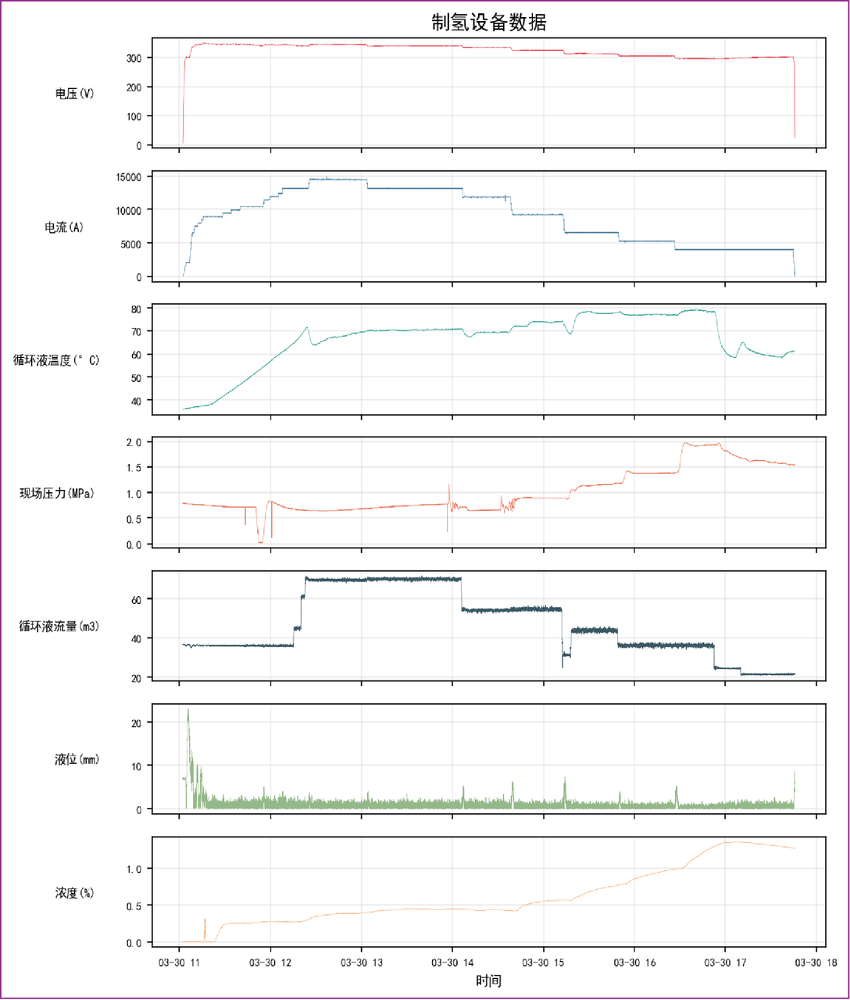
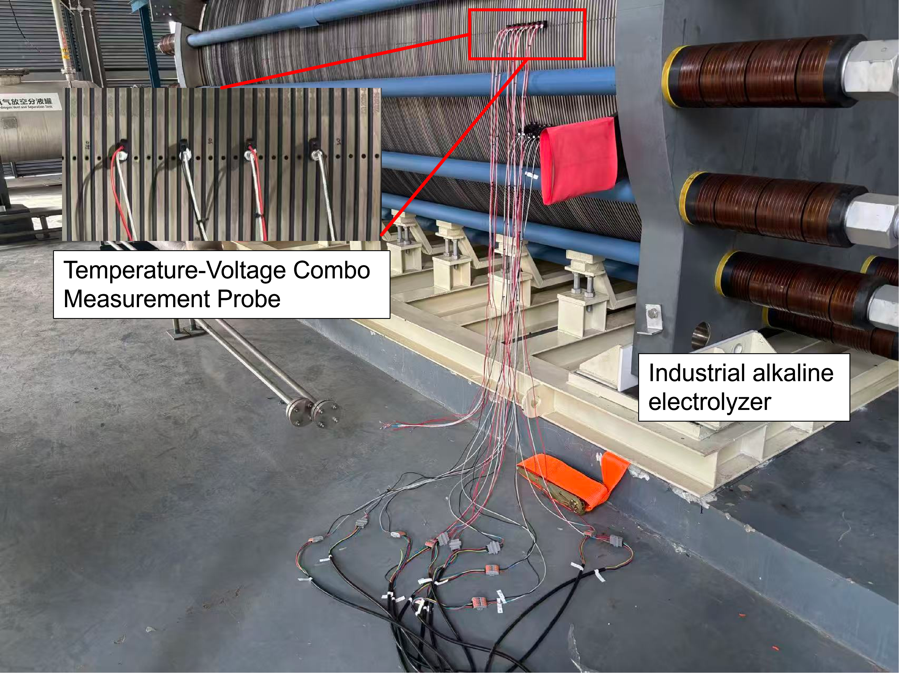
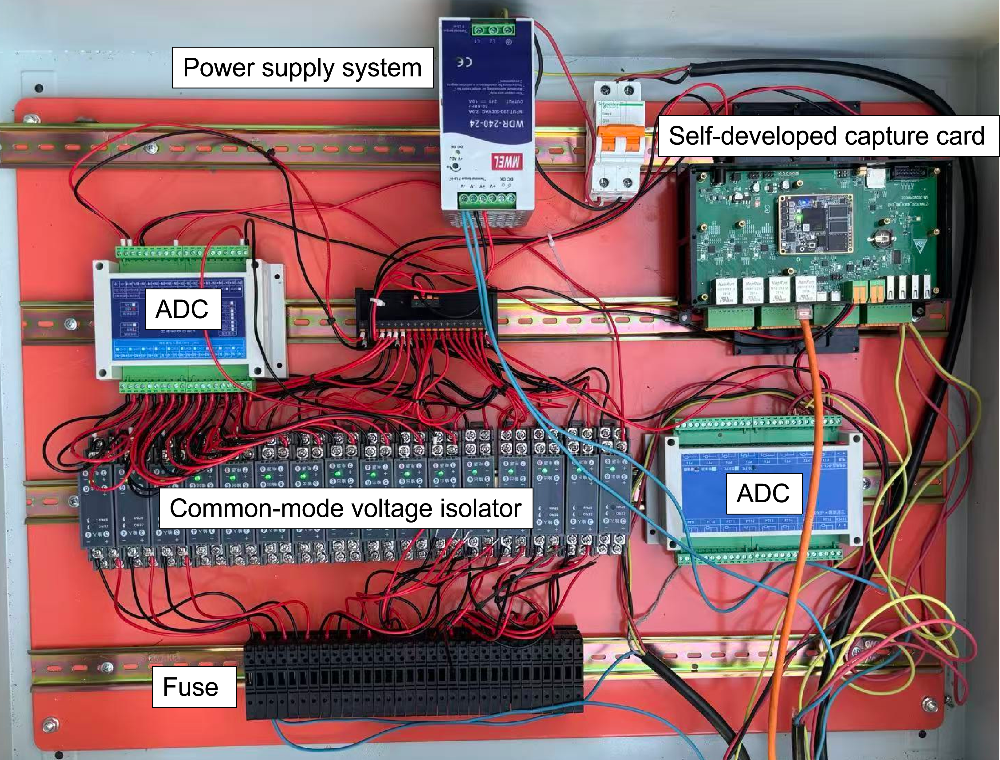
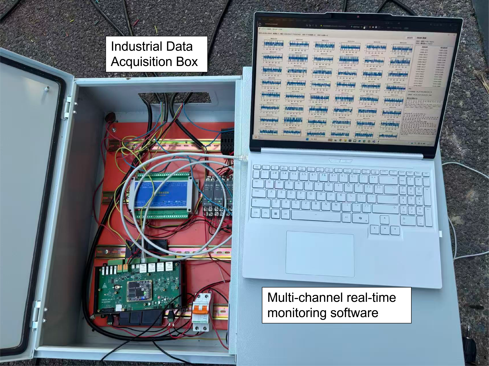
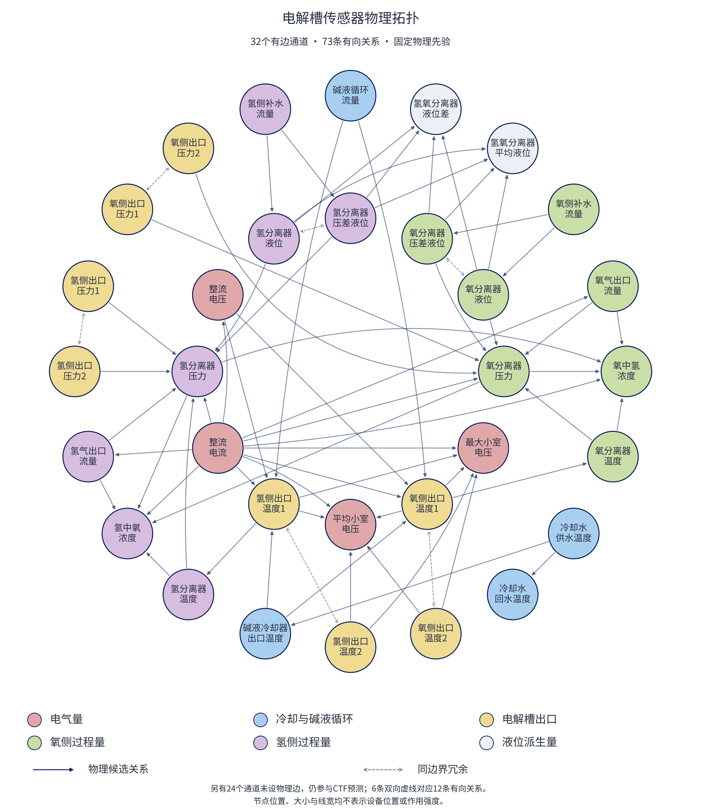
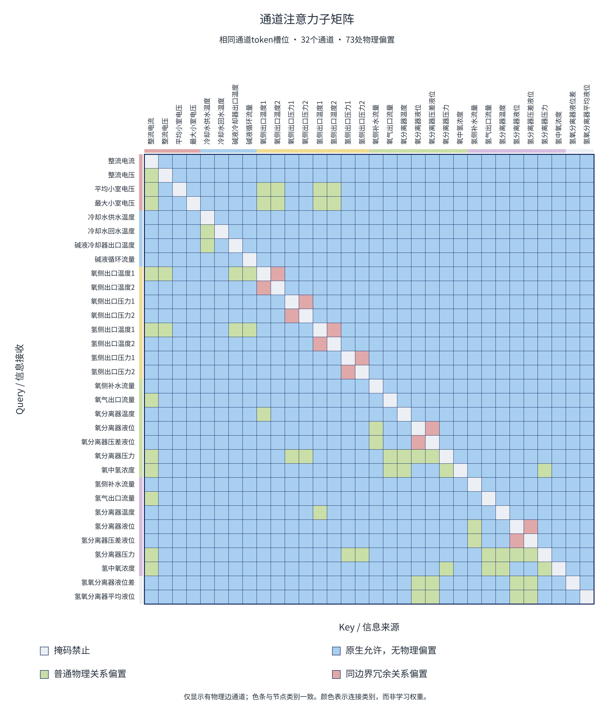
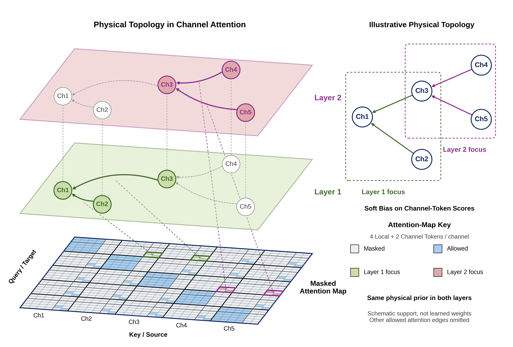
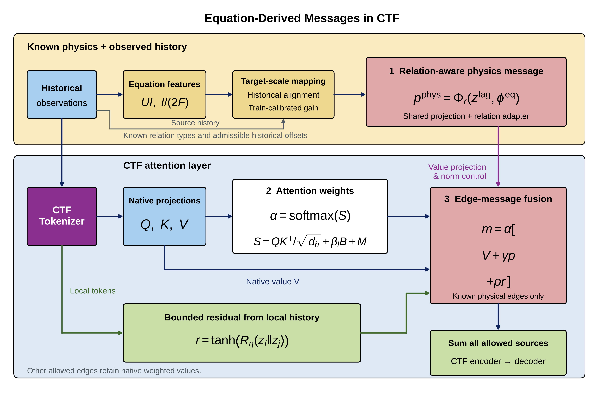

# PhysicsRelationCTF（PRCTF）

[English](README.md) | **简体中文**

## 面向电解槽运行监控与故障预警的物理增强时序预测

**复杂物理系统的故障预警，需要了解设备运行状态未来可能如何变化。** 以制氢设备为例，电流、电压、温度、压力、流量及气体成分等监测数据反映当前运行状态；对这些变量的未来轨迹进行预测，可以为后续异常判断、故障预警及运行决策提供提前量。

可靠预测的难点在于，不同变量受到电化学、传热、流体输运与控制过程的共同影响。研究者往往掌握部分物理关系，却缺少完整设备参数、测量边界与动态方程，难以建立完整机理模型。因此，本项目关注的核心问题是：**如何利用已有物理知识改善预测，同时保留对未知动态的学习能力？**

**PhysicsRelationCTF（PRCTF）**在**ChannelTokenFormer（CTF）**的注意力机制中，从结构层与内容层引入物理知识：物理拓扑说明**哪些通道存在关系依据**，方程消息提供**已知关系能够计算的信息**，数据驱动注意力与轻量残差分支则学习未知依赖和未建模效应。

**应用链路：** 多传感器监测 → **PRCTF预测未来测量轨迹** → 后续异常判断与故障预警。

工业模型使用**过去96 s的历史观测，预测未来96 s内56个监控通道的变化轨迹**。本项目实验评价其中的预测环节；故障预警准确率与提前量需要在下游预警任务中另行验证。

<p align="center">
  
</p>

*模型总体结构，对应论文图3所介绍的方法。两个物理接口在注意力内部工作，不以独立图编码器替换通道token，也不在最终预测曲线上另加一条补偿曲线。*

> **归档预测结果：** 工业数据上，相比Original CTF，三种子平均归一化MSE由**0.10901降至0.10858**，降幅为**0.393%**；配对单种子最高降幅为**1.275%**。LBNL冷水机组与Tennessee Eastman过程（TEP）仿真进一步使用各自系统的物理知识进行验证。

本仓库提供模型实现、物理关系配置、归档实验记录、图像，以及三个系统的**[PRCTF预训练权重](weights/README_zh-CN.md)**。权重包同时包含推理所需的归一化与标定参数。论文PDF与工业原始观测序列保留在本地。

**无需重训即可部署：** [安装依赖并获取固定版本CTF](#quick-start)后，运行`python scripts/predict.py --dataset industrial --input history.csv --output outputs/forecast.csv`。输入要求见[预训练推理](#pretrained)。

### 目录

- [1. 从故障预警需求到传感器预测](#problem)
  - [硬件与软件平台](#hardware)
- [2. 从物理方程到可用先验](#physics)
- [3. 模型结构与物理信息嵌入](#architecture)
- [4. 实验设置与论文结果](#results)
- [5. 安装与快速核验](#quick-start)
  - [预训练权重与推理](#pretrained)
- [6. 公开数据准备与训练](#reproduce)
- [7. 代码与实验位置](#code-map)
- [8. 已公开插图与论文对应关系](#figures)
- [9. 结论边界与复现限制](#limits)
- [10. 致谢、许可与引用](#citation)

<a id="problem"></a>
## 1. 从故障预警需求到传感器预测

### 1.1 为什么需要预测监测变量？

监测回答设备“当前处于什么状态”，预测则进一步估计这些状态“接下来可能如何变化”。对于碱性电解槽，温度、压力、流量及气体成分的预测趋势，可以为下游预警系统提供前瞻信息。

本项目将这一应用过程划分为三个相互衔接的环节：

| 环节 | 目的 | 本项目中的对应内容 |
|---|---|---|
| 多传感器监测 | 记录设备的可观测运行状态。 | 工业监控记录提供预测数据；另行开发的采集平台见下文。 |
| 未来轨迹预测 | 估计多个过程变量的后续变化。 | PRCTF完成实验所评价的56通道、未来96 s预测任务。 |
| 异常判断与故障预警 | 结合预测结果、适用阈值、残差或运行规则作出判断。 | 属于预测结果的下游应用，预警效果不由当前预测误差指标直接衡量。 |

<p align="center">
  
</p>

*工业测量示例。该成品图用于定性介绍信号，不代表公开了底层数值记录。*

### 1.2 为什么在预测中引入物理AI？

这些测量共同反映电气、电化学、气液分离、循环、冷却及控制过程。纯数据驱动模型能够学习有用的统计依赖，但没有显式区分哪些关系具有物理依据；完整机理预测又需要监控记录中缺少的设备参数、边界条件与运行操作信息。

局部知识仍然可以利用。例如，电流影响电化学产气，电流与电压决定电功率，循环流量和温差表征热输运。PRCTF将这些关系转化为**注意力引导与方程消息**，同时保留CTF对现有物理知识无法描述部分的预测学习能力。

模型遵循的原则是：**已知物理能够计算的部分直接计算，其余动态由数据学习补充。** 例如，法拉第产气参考量具有明确物理意义，但它与下游流量计读数之间仍存在未知设备增益、气体库存及输运响应，需要结合观测学习。

<a id="hardware"></a>
### 1.3 硬件与软件平台

为衔接测量采集与预测应用，本项目配套建设了面向电解槽的工程平台，包括自研温度电压二合一测量探头、自研数据采集箱和多通道监控软件。

硬件已具备测量数据采集能力。连接上位机后，监控软件可处理与模型配置匹配的信号，并运行预测模型，为实时监控与预警流程提供支持。模型推理在上位机运行。

> **数据来源说明：论文训练、验证和测试使用的工业监控记录并非由下方展示的自研硬件采集。** 这三张照片用于介绍另行开发的采集与监控平台，不作为论文实验数据的来源证明。

<table>
  <tr>
    <td width="50%" valign="top">
      <a href="figures/hardware/电解槽测量图.png"></a>
      <br><strong>真实电解槽与自研温度电压二合一测量探头。</strong> 局部放大图展示探头在电解堆上的安装位置。
    </td>
    <td width="50%" valign="top">
      <a href="figures/hardware/电解槽测量箱.png"></a>
      <br><strong>自研电解槽数据采集箱。</strong> 箱内集成采集板、ADC模块、信号隔离、电源及保护部件。
    </td>
  </tr>
</table>

<p align="center">
  <a href="figures/hardware/软硬件结合.png"></a>
</p>

*采集箱与计算机连接后的多通道监控界面。软件展示采集信号，并提供接入预测模型与预警功能的上位机平台。*

实际部署时，采集信号需与检查点所要求的通道定义、单位、采样率、归一化及物理关系配置相匹配。图中的温度电压探头本身不意味着已经提供归档工业模型所需的全部56个通道。

照片用于展示采集与监控平台，实验表格用于评价预测准确率。公开材料包含这些图片与说明，暂不包含硬件设计、采集固件或监控软件源码。

<a id="physics"></a>
## 2. 从物理方程到可用先验

利用局部物理知识，需要回答两个问题：**哪些测量量具有物理关系依据，以及这些关系能够提供什么有用信息？** 前者形成稀疏有向图，后者形成由历史观测计算的方程特征。以下以电解槽为例，依据过程含义与可用方程组织测量信息。

| 过程知识 | 可用关系或特征 | 使用方式 |
|---|---|---|
| 电气输入 | `P = UI` | 关联电流、电压、电功率及热状态预测。 |
| 电化学极化 | 小室电压受到可逆电压、过电位和电阻压降影响。 | 支持电流、温度至小室电压的关系，不求解完整极化电压。 |
| 法拉第产气 | 单小室理想参考量`I/(2F)`、`I/(4F)`。 | 提供产气参考特征，不作为已校准的设备出口流量。 |
| 碱液热输运 | 循环流量与出口、入口温差的乘积。 | 构造热输运代理量，不补造未知物性参数。 |
| 冷却过程 | 冷却水回水与供水温差。 | 提供基于观测的热状态参考。 |
| 气液库存与杂质 | 局部平衡关系、分离器压力、液位、补水及压差。 | 支持选定关系和可计算代理量，完整库存与杂质动态仍然未知。 |
| 同边界测量 | 具有共同测量边界的成对读数或派生量。 | 提供有限的一致性关系，而非同量纲全连接图。 |

### 2.1 第一步：表达哪些通道存在关系依据

冻结的电解槽物理图包含**56个通道、73条有向关系、9类关系**。节点图只展示其中**32个具有物理边的通道**；没有先验边的通道仍参与预测和原生数据注意力。

九类关系为电气、电化学极化、产气、气体输运、热过程、液体输运与库存、气体库存、杂质及同边界一致性。只保留有依据的直接关系，不采用相关系数构图，不人为增加`A²/A³`，也不通过独立GCN生成通道token。

<p align="center">
  
</p>

<p align="center">
  
</p>

*节点图与通道矩阵表示同一个固定先验，对应论文图2的表达。矩阵行接收信息，列提供信息；颜色表示先验连接位置，不表示训练后的注意力强度或已辨识的因果效应。*

### 2.2 第二步：表达这些关系能够计算什么

仅将**历史观测**代入已知函数。例如，96个历史电流值可以得到96个理想产氢参考值`I/(2F)`。由于小室数量、法拉第效率、气体库存及输运条件未知，该参考量不能直接作为设备出口流量。

方程特征经过仅由训练集确定的观测标定、允许范围内的历史对齐及轻量关系适配，转换为目标通道可利用的表示。对法拉第示例而言，常数缩放不会增加独立观测信息；其作用是提供具有物理含义的参考表示及消息路径，而不是完整求解产气至出口流量的动态过程。

这两步分别提供**结构引导与数值参考内容**，数据驱动路径继续学习已知方程没有描述的依赖和响应。

逐边依据、关系类型及限制见[电解槽图配置](configs/industrial/graph.json)和[方程实现](workspace/PhysicsRelationCTF/physics.py)。LBNL与TEP分别使用适合各自系统的[图配置](configs/lbnl/graph.json)、[方程与图定义](configs/tep/graph.json)，不直接照搬电解槽的物理关系。

<a id="architecture"></a>
## 3. 模型结构与物理信息嵌入

两类知识通过互补接口进入同一个CTF预测骨干：**拓扑改变对信息来源的读取偏好，方程消息补充从该来源读取的具体内容。** 原生数据驱动路径继续学习已知物理关系尚未覆盖的依赖。

### 3.1 保留原生CTF预测路径

PRCTF保留CTF的patch嵌入、可学习通道token、掩码注意力及**通道token解码器**：

1. 对各通道历史归一化，将完整patch编码为局部token。
2. 引入原生可学习通道token。
3. 局部token仅读取本通道局部token；通道token读取本通道历史，以及其他通道相同槽位的通道token。
4. 经过多层注意力后，仅由更新后的通道token解码多步预测。

电解槽配置中，每通道包含4个长度为24的真实历史patch及2个通道token。不使用local token解码、不复制观测补齐，也不采用已废弃的`GCN → 替换channel token`路径。

### 3.2 结构接口：物理拓扑引导注意力偏置

邻接矩阵约定为：

```math
A^{\mathrm{phys}}_{ij}=1 \quad\Longleftrightarrow\quad j\rightarrow i.
```

轻量网络依据历史信息调节已知物理边的引导强度。电解槽实现中：

```math
b_{ij}(X)=1+\tfrac12\tanh\!\left(g_\phi(\xi_{ij}(X))+a_{r_{ij}}\right).
```

`xi_ij`汇总相应历史信息，`a_r`是不同关系类型的可学习基础强度。调制范围为`(0.5, 1.5)`，不新增物理连接。

物理偏置仅映射到**相同槽位的Channel–Channel位置**，加入原生注意力分数：

```math
\alpha^{(l)}=\mathrm{Softmax}_{\mathrm{key}}\left(
\frac{Q^{(l)}K^{(l)\top}}{\sqrt{d_h}}+\beta_l B(X_{\mathrm{hist}})+M
\right).
```

`M`仍是CTF原生掩码。正偏置表示更倾向读取该来源，不代表实际物理响应必为正。未被物理先验覆盖的其他允许交互仍由数据学习。

<p align="center">
  
</p>

*物理拓扑至注意力的映射，对应论文图4。各层共享相同先验，图中突出不同路径用于解释逐层传播。该机制具有图消息聚合的含义，但并非经典GCN算子的严格等价改写。*

### 3.3 内容接口：物理方程消息

经过目标尺度转换和历史对齐后，关系消息可以概括为：

```math
p^{\mathrm{phys}}_{ij}
=E_P(\phi^{\mathrm{eq}}_{ij})
+\mathrm{Adapt}_{r_{ij}}\left(
E_P(\phi^{\mathrm{eq}}_{ij})\Vert E_P(z^{\mathrm{lag}}_{j\to i})
\right).
```

`phi_eq`是预处理后的方程特征，`z_lag`是对齐后的源通道历史，`E_P`复用CTF的patch投影。适配器拼接的是**方程特征编码与源历史编码**，并非直接将一个参考流量拼到初始目标流量token后。

<p align="center">
  
</p>

*方程消息的构造与注入，对应论文图5。已知方程提供关系特征，投影与轻量适配将其转换为CTF可处理的消息。*

### 3.4 在注意力内部融合物理与数据

电解槽实例的聚合过程可以概括为：

```math
O_i^{(l)}=O_{\mathrm{data},i}^{(l)}
+\sum_{j:\,j\to i\in\mathcal E}\widetilde\alpha_{ij}^{(l)}
\left(\gamma_l\overline p_{ij}^{(l)}+\rho_l\overline r_{ij}^{(l)}\right).
```

方程消息复用上一接口得到的注意力权重。轻量残差网络读取源、目标通道的局部历史，补充未建模效应。原生value继续在全部允许来源上聚合，之后沿用CTF编码器和通道token解码器，不在最终预测后再叠加独立补偿曲线。

可学习的`beta`、`gamma`和`rho`分别控制拓扑引导、方程注入与残差补偿。工业实现采用非负或有界参数化及消息范数控制。显式关闭**三项增强路径**后恢复配对Original CTF的前向计算；仅设置`beta = 0`不会关闭其余消息。

可执行的电解槽归档配置使用`representation="centered"`。公开实例另有已记录的目标水平表示、有效性检查和物理邻居条件归一化；复现时以[配置快照](configs)和[源码入口](#code-map)为准。

<a id="results"></a>
## 4. 实验设置与论文结果

实验检验局部物理知识是否改善**多变量时序预测准确率**，并通过组件对照分析拓扑引导与方程消息的作用。工业电解槽记录用于应用验证，LBNL与TEP仿真则在更换物理关系后检验相同融合思路。以下表格保留论文归档实验的评价协议与数值。

### 4.1 固定评价协议

全量训练数据实验使用固定种子**42、43、44**。CTF与PRCTF配对共享数据划分、观测、预测长度、目标、预处理、公共骨干初始化及训练策略。归一化和观测标定仅使用训练数据，检查点由验证误差选择。

| 数据集及用途 | 采样间隔 | 输入／评价通道 | 输入→输出 | patch |
|---|---|---:|---:|---:|
| 工业电解槽：实际应用验证 | 1 s | 56／56 | 96→96点 | 24 |
| LBNL冷水机组：物理模块仿真验证 | 1 min | 73／58 | 96→96点 | 24 |
| TEP：物理模块仿真验证 | 3 min | 52／52 | 20→20点 | 5 |

工业预测长度是**分钟级任务设定**，不是已辨识的物理时间常数，也不宣称是最优预测时长。公开任务的采样间隔不同，对应的真实预测时间也不同。各实例单独建模、单独训练，不是零样本迁移。

LBNL使用EnergyPlus与Modelica联合生成的正常无故障冷水机组仿真数据，包含水温、流量、功率、控制及天气变量。TEP使用正常无故障化工过程仿真轨迹，包含41个测量量与11个操纵量。公开来源和固定子集见[数据准备部分](#reproduce)。

### 4.2 两个物理模块的仿真数值验证

对应论文表6，完整模型与**分别重新训练**的单接口关闭模型比较。下表为三种子均值；保留更多小数，以区分TEP几乎持平的结果。

| 数据集 | 配置 | 归一化MSE | 归一化MAE |
|---|---|---:|---:|
| LBNL | **完整PRCTF** | **0.00255002** | **0.00456146** |
| LBNL | 关闭注意力偏置 | 0.00255095 | 0.00460462 |
| LBNL | 关闭方程消息 | 0.00257068 | 0.00464841 |
| TEP | 完整PRCTF | 0.82118871 | 0.70023528 |
| TEP | **关闭注意力偏置** | **0.82118710** | **0.70023496** |
| TEP | 关闭方程消息 | 0.82708094 | 0.70287048 |

- **注意力偏置：**`no_bias`固定`beta = 0`，保留方程与残差消息。关闭后LBNL略差；TEP几乎不变，且消融模型数值略优。
- **方程消息：**`no_equation`固定`gamma = 0`。相对该模型，完整PRCTF在**LBNL、TEP上的平均MSE分别降低0.804%、0.712%**。
- 方程数值消息的收益更一致，不能据此宣称两个接口在每个系统中都独立带来提升。

来源：[完整消融与输入对照记录](results/ablation_and_input_per_seed.csv)。其中也保留电解槽组件结果，供补充核对。

### 4.3 PRCTF与原生CTF的配对比较

对应论文表7，下表为三种子均值，越低越好。不同任务的归一化尺度和评价目标不同，不直接横向比较或合并总误差。

| 数据集 | 模型 | 归一化MSE | 归一化MAE |
|---|---|---:|---:|
| 工业电解槽 | Original CTF | 0.10901009 | 0.10809476 |
| 工业电解槽 | **PRCTF** | **0.10858198** | **0.10775839** |
| LBNL | Original CTF | 0.00257001 | 0.00462957 |
| LBNL | **PRCTF** | **0.00255002** | **0.00456146** |
| TEP | Original CTF | 0.82707916 | 0.70286754 |
| TEP | **PRCTF** | **0.82118871** | **0.70023528** |

降幅定义为`100 ×（CTF误差 − PRCTF误差）/ CTF误差`，**正值表示误差减小**。

| 数据集 | 平均MSE降幅 | 平均MAE降幅 | 配对单种子最高MSE降幅 | MSE胜出组数 |
|---|---:|---:|---:|---:|
| 工业电解槽 | **0.393%** | 0.311% | 1.275% | 2／3 |
| LBNL | **0.778%** | 1.471% | 2.588% | 2／3 |
| TEP | **0.712%** | 0.375% | 0.760% | 3／3 |

结果支持在针对系统配置物理知识后，相对同一CTF骨干获得小幅平均收益。不据此宣称普遍领先、小数据优势必然增大或三个种子已证明统计显著性。单种子最高降幅不等于平均改善。

<details>
<summary>全部九组配对MSE，包含退化种子</summary>

| 数据集 | 种子 | CTF MSE | PRCTF MSE | 降幅 |
|---|---:|---:|---:|---:|
| 电解槽 | 42 | 0.10912231 | 0.10773149 | +1.275% |
| 电解槽 | 43 | 0.10858620 | 0.10884467 | −0.238% |
| 电解槽 | 44 | 0.10932176 | 0.10916977 | +0.139% |
| LBNL | 42 | 0.00258835 | 0.00253391 | +2.103% |
| LBNL | 43 | 0.00253232 | 0.00259382 | −2.428% |
| LBNL | 44 | 0.00258936 | 0.00252234 | +2.588% |
| TEP | 42 | 0.82692956 | 0.82170499 | +0.632% |
| TEP | 43 | 0.82592958 | 0.81965383 | +0.760% |
| TEP | 44 | 0.82837836 | 0.82220730 | +0.745% |

逐组MAE见[ctf_prctf_paired.csv](results/ctf_prctf_paired.csv)；标准差与各指标最优值见[method_comparison_summary.csv](results/method_comparison_summary.csv)。

</details>

### 4.4 工业电解槽上的预测方法对比

按照论文表8，主要应用对比包含**Original CTF、MTGNN、PatchTST、PhyGNN预测适配版与PRCTF**。Mean为三个固定种子的均值；Best为对应指标在三次运行中的最小值，MSE与MAE的Best不要求来自同一种子。

| 模型 | MSE Mean | MSE Best | MAE Mean | MAE Best | 历史训练时间（s） |
|---|---:|---:|---:|---:|---:|
| Original CTF | 0.10901 | 0.10859 | 0.10809 | 0.10796 | 514.1 |
| MTGNN | 0.11012 | 0.10974 | 0.10800 | 0.10701 | 182.2 |
| PatchTST | 0.11145 | 0.11076 | 0.11124 | 0.11022 | 89.2 |
| PhyGNN适配版 | 0.14649 | 0.14365 | 0.18030 | 0.17610 | **69.8** |
| **PRCTF** | **0.10858** | **0.10773** | **0.10776** | **0.10695** | 615.2 |

在这五种已评价配置中，PRCTF的平均和最优MSE、MAE均最低。平均MSE相对**CTF降低0.393%，相对MTGNN降低1.398%，相对PatchTST降低2.571%**。PRCTF并非训练最快；耗时是历史运行的平均记录，不是统一硬件或等参数量条件下的效率基准。

PhyGNN保留公开图聚合模块并增加预测头，是任务适配而非原论文任务的完整复现。对比方法扩展经过种子42预实验筛选，排名属于探索性应用比较。见[模型适配说明](workspace/PhysicsRelationCTF/runs/physics_ai_comparison_v1/UPSTREAM.md)。

来源：[逐种子方法结果](results/method_comparison_per_seed.csv)、[mean/std/best/耗时汇总](results/method_comparison_summary.csv)。

### 4.5 工业滚动预测曲线示例

<p align="center">
  
</p>

*作者选用的图C：仪表空气总管现场压力（PT010003）。蓝色为滤波观测，红色为PRCTF，灰色虚线为Original CTF。预测每12秒更新一次，对重叠部分采用等权平均。*

曲线来自**独立的种子42低通实验**：训练、验证和测试观测均采用截止频率0.05 Hz的二阶因果Butterworth低通滤波。保留既有权重，每次仍输入96秒历史、输出96步；展示策略改为每12秒滚动更新，并对重叠预测等权平均。图中保留全部**4847个测试点**，阴影标记最初96秒融合预热区，两模型统一在后续**4751点**上计算指标。

在该通道和策略下，CTF与PRCTF的MSE分别为**1.603082 × 10⁻⁶和1.569092 × 10⁻⁶ MPa²**，PRCTF降低**2.12%**。融合曲线混合了**提前1–96秒**的预测，平均提前量约48.5秒，不代表固定提前96秒的预测精度。没有时间平移或额外的融合后滤波。该示例与原始数据三种子基准及已发布的参考权重分别说明；默认单窗口推理接口保持不变。

### 4.6 保留完整历史证据

仓库保留**7种方法 × 3个数据集 × 3个种子，共63条记录**，其中EquationInput-CTF和PG-Reg-CTF为额外的自定义对照。不将它们列入上述五种主要应用对比，也不称作独立发表架构或完整系统的标准PINN。

PRCTF并非在所有数据集上优于所有保留方法：LBNL上MTGNN与PatchTST的平均MSE更低，TEP上EquationInput-CTF与PG-Reg-CTF的平均MSE更低。这些结果仍保留在[完整汇总](results/method_comparison_summary.csv)和[结果说明](results/README.md)，不因论文主对比范围调整而删除。

<a id="quick-start"></a>
## 5. 安装与快速核验

### 5.1 配置环境并获取固定版本 CTF

建议使用 Python 3.10 或兼容环境。请先根据 CPU/CUDA 环境安装合适的 PyTorch，研究代码使用的接口要求 **PyTorch ≥ 2.7**。依赖快照记录的是打包时的软件环境，不代表已经完整还原原训练环境。

```bash
git clone https://github.com/field-mx/PhysicsRelationCTF.git
cd PhysicsRelationCTF

python -m venv .venv
source .venv/bin/activate

# 先安装适合本机的 PyTorch，再安装其余模型依赖。
pip install -r requirements-model.txt

# 获取第三方源码前，先阅读 THIRD_PARTY_NOTICES.md。
python scripts/fetch_upstreams.py --ctf
```

脚本获取 CTF 固定版本 `b1c100effb9c27cd25de07e91de7f9005d18d5e7`，仓库不直接捆绑该源码。若目标上游目录已经存在，脚本拒绝覆盖。需要对照方法源码时，可在确认相应许可后单独运行 `python scripts/fetch_upstreams.py --comparators`。

### 5.2 检查文件、表格与模型前向过程

```bash
# 核对当前发布文件，包括文档与预训练权重。
python scripts/verify_package.py
python scripts/summarize_results.py

# 安装依赖并获取 CTF 后，分别运行各实例的合成输入测试。
python scripts/smoke_test.py --dataset industrial
python scripts/smoke_test.py --dataset lbnl
python scripts/smoke_test.py --dataset tep
```

当前发布清单覆盖文档、硬件照片、预训练权重及原有代码与证据。原打包清单保留为[files.packaging-v1.json](manifests/files.packaging-v1.json)。结果核对不重新训练或评价模型。

测试使用相同公共骨干权重构造配对模型，检查输出有限，并在显式关闭全部物理接口后与 CTF 比较。已记录的三组 CPU 打包测试最大绝对差均为 **0.0**。这只验证合成输入下的执行与退化等价性，不验证预测精度。工业测试中的合成单位统计量有明确标注，不会替代真实工业训练数据。

可添加 `--device cuda:0` 在 GPU 上执行；也可通过 `--ctf-root /path/to/ChannelTokenFormer` 指定已存在的固定版本 CTF 目录。

<a id="pretrained"></a>
### 5.3 预训练权重与推理

发布的三个模型为归档全数据实验中的**固定seed=42参考检查点**，训练轮次由验证误差选择。本次没有重新训练或筛选种子。电解槽权重使用原始完整训练池，不是后来仅用12:00之后记录的重训版本。

| 模型 | 训练后权重 | 真实历史→预测 | 输入／默认输出通道 |
|---|---|---|---|
| 工业电解槽 | [prctf_seed42.pt](weights/industrial/prctf_seed42.pt) | 96→96，间隔1 s | 56／56 |
| LBNL冷水机组 | [prctf_seed42.pt](weights/lbnl/prctf_seed42.pt) | 96→96，间隔60 s | 73／58 |
| TEP | [prctf_seed42.pt](weights/tep/prctf_seed42.pt) | 20→20，间隔180 s | 52／52 |

```bash
python scripts/predict.py --dataset industrial \
  --input /path/to/history.csv --output outputs/forecast.csv --device cpu
```

CSV表头需包含要求的通道ID；脚本读取最后一个完整历史窗口，按名称恢复通道顺序。输入物理单位下的数值，不要提前标准化。电解槽使用原测量单位，LBNL使用预处理后的SI量，TEP使用原数据单位。加载器自动应用训练时的归一化参数，并将预测恢复为相同物理单位。不会补齐短历史、填补非有限值或覆盖已有输出文件。

GPU推理使用`--device cuda:0`。[Python接口与完整单位说明](weights/README_zh-CN.md)还介绍批量推理和LBNL目标选择。[manifest.json](weights/manifest.json)记录哈希、输入定义与检查点来源；[部署核验记录](weights/VALIDATION.md)说明权重导出及推理检查，不分发工业原始观测序列。

<a id="reproduce"></a>
## 6. 公开数据准备与训练

### 6.1 获取对应公开数据子集

| 数据集 | 公开来源 | 本研究使用范围 |
|---|---|---|
| LBNL | [冷水机组官方页面](https://faultdetection.lbl.gov/dataset/simulated-chiller-plant/) · [数据集合 DOI](https://doi.org/10.25984/1881324) | 仅使用无故障 `ChillerPlant.csv`，不混用全部故障场景。 |
| TEP | [Harvard Dataverse 数据记录](https://doi.org/10.7910/DVN/6C3JR1) · [获取镜像](https://www.kaggle.com/datasets/averkij/tennessee-eastman-process-simulation-dataset) | 无故障训练、测试 RData 文件中的固定运行编号。 |

LBNL 按时间划分为 **367878 / 78831 / 78831 点**。TEP 使用训练文件的 **1–80** 号运行训练、**81–100** 号运行验证，测试文件的 **401–500** 号运行测试。公开原始数据仅附来源，不在本仓库镜像分发。完整引用、来源、访问条件与校验记录见 [DATA_AVAILABILITY.md](DATA_AVAILABILITY.md)。

```bash
pip install -r requirements-data.txt
python scripts/prepare_public_data.py --dataset lbnl
python scripts/prepare_public_data.py --dataset tep
```

准备脚本检查原文件哈希与任务成员，不启动训练。下载和认证条件可能变化；打包过程中没有重新执行完整大文件获取，因此不将这些入口描述为已经全面重测的下载服务。

### 6.2 配对训练 CTF 与 PRCTF

```bash
# LBNL：96 点历史预测未来 96 点。
python scripts/train_public.py --dataset lbnl --kind CTF --seed 42 --device cuda:0 --out outputs/lbnl_seed42
python scripts/train_public.py --dataset lbnl --kind Physics --seed 42 --device cuda:0 --out outputs/lbnl_seed42

# TEP：20 点历史预测未来 20 点。
python scripts/train_public.py --dataset tep --kind CTF --seed 42 --device cuda:0 --out outputs/tep_seed42
python scripts/train_public.py --dataset tep --kind Physics --seed 42 --device cuda:0 --out outputs/tep_seed42
```

`Physics` 对应 PRCTF。其余实验使用固定种子 **43、44**，不通过搜索种子寻找有利结果。入口**仅使用 Train/Validation 训练与选择检查点，不自动运行 Test**。新实验使用新的输出位置，脚本禁止将发布的证据目录指定为训练输出。

| 实例 | beta / gamma / rho 初始值 | 学习率 | 最大轮数 | batch size |
|---|---|---:|---:|---:|
| 电解槽 | 0.05 / 0.75 / 0.001 | 0.0001 | 16 | 32 |
| LBNL | 0.05 / 0.10 / 0.001 | 0.0003 | 32 | 32 |
| TEP | 0.05 / 0.75 / 0.001 | 0.0003 | 16 | 64 |

三个实例的 CTF 骨干均采用隐藏维度 256、FFN 维度 1024、2 层编码器、8 个注意力头、每通道 2 个通道 token、dropout 0.1。上述文件是初始化与结构配置，**不是训练后权重**；注入强度在训练中继续学习。

**最终测试单独进行：** 先锁定两个模型由验证集选择的检查点，再使用保留的评价函数开展测试。可移植入口不承诺“一条命令逐位复现论文误差”。评价约定与历史运行依赖见 [REPRODUCIBILITY.md](REPRODUCIBILITY.md)。

### 6.3 工业数据的复现边界

工业原始观测序列与作图源序列不随仓库分发。[预训练包](weights/industrial/prctf_seed42.pt)现已包含模型权重，以及对兼容测量进行推理所需的尺度与增益聚合统计。重新训练和核对工业测试误差，仍需原始记录的授权访问。仓库不作未经确认的“可申请获取数据”等承诺。

<a id="code-map"></a>
## 7. 代码与实验位置

```text
.
├── README.md / README_zh-CN.md     # 中英文说明及切换
├── DATA_AVAILABILITY.md           # 数据来源、子集与访问边界
├── REPRODUCIBILITY.md             # 训练评价约定与限制
├── configs/{industrial,lbnl,tep}/  # 冻结的模型配置与物理图
├── weights/                      # 训练后PRCTF权重与推理输入约定
├── results/                      # 完整对比与组件对照表格
├── figures/                      # 获准公开的 PNG/PDF 成品图
├── scripts/                      # 推理、模型构造、数据准备和核验入口
├── tests/                        # 预训练模型部署检查
├── manifests/                    # 文件哈希与来源映射
└── workspace/
    ├── PhysicsRelationCTF/        # 精选模型、实验源码与数值证据
    ├── PhysicsGuidedCTF/          # CTF 通道解码封装和数据工具
    └── GNN_Transformer/           # 所需的历史物理拓扑定义
```

`workspace/` 保留相邻目录结构是为了兼容原有相对导入，并非上传整台服务器工作区。存在 `GNN_Transformer/` 不表示当前模型仍使用旧版 GCN 编码器。

| 查看内容 | 代码入口 |
|---|---|
| 可移植的配对模型构造 | [scripts/model_factory.py](scripts/model_factory.py) |
| 训练后模型加载与Python推理 | [scripts/pretrained.py](scripts/pretrained.py) |
| 按通道名称读取CSV并预测 | [scripts/predict.py](scripts/predict.py) |
| 电解槽拓扑偏置、消息投影、聚合与残差 | [relation_model.py](workspace/PhysicsRelationCTF/relation_model.py) |
| 电解槽方程函数、关系类型和历史范围 | [physics.py](workspace/PhysicsRelationCTF/physics.py) |
| 原生 CTF 通道 token 解码封装 | [PhysicsGuidedCTF/model.py](workspace/PhysicsGuidedCTF/model.py) |
| 当前 LBNL 物理消息实现 | [model_v7.py](workspace/PhysicsRelationCTF/runs/publicdata_exp/optimization_v2/model_v7.py) 及其保留的导入模块 |
| LBNL 方程与控制参考量定义 | [public_physics_v4.py](workspace/PhysicsRelationCTF/runs/publicdata_exp/public_physics_v4.py) 及其导入模块 |
| TEP 方程库与标定 | [tep_physics.py](workspace/PhysicsRelationCTF/runs/TEP/tep_physics.py) |
| 当前 TEP 20→20 适配器 | [length_model.py](workspace/PhysicsRelationCTF/runs/TEP/window_search_v1/length_model.py) |
| 组件对照与直接方程输入实验 | [paper_minimal_v1](workspace/PhysicsRelationCTF/runs/paper_minimal_v1) |
| 电解槽方法对比适配与记录 | [physics_ai_comparison_v1](workspace/PhysicsRelationCTF/runs/physics_ai_comparison_v1) |
| 公开数据的方法对比记录 | [physics_ai_comparison_public_v1](workspace/PhysicsRelationCTF/runs/physics_ai_comparison_public_v1) |
| 原文件与公开副本的对应关系 | [manifests/source_map.json](manifests/source_map.json) |

`paper_minimal_v1` 只是组件对照实验的历史目录名，不包含论文正文。部分历史总控脚本依赖原缓存、权重锁或工业标定信息；公开的免权重模型构造和 Train/Validation 训练应使用 `scripts/` 入口，不应把每个历史总控都理解为可独立直接运行的脚本。

<a id="figures"></a>
## 8. 已公开插图与论文对应关系

下表列出模型插图和配套工程平台照片。硬件照片用于介绍系统组成，不作为新增预测实验或故障预警实验的结果；不新增上传论文文件。

| 论文中的内容 | 已公开PNG | 已公开PDF |
|---|---|---|
| 图2(a)：电解槽物理拓扑（英文） | [查看](figures/topology/electrolyzer_topology_en.png) | [下载](figures/topology/electrolyzer_topology_en.pdf) |
| 图2(b)：通道关系子矩阵（英文） | [查看](figures/topology/electrolyzer_channel_attention_en.png) | [下载](figures/topology/electrolyzer_channel_attention_en.pdf) |
| 中文电解槽拓扑 | [查看](figures/topology/electrolyzer_topology_zh.png) | [下载](figures/topology/electrolyzer_topology_zh.pdf) |
| 图3：模型总体结构 | [查看](figures/architecture/model_architecture.png) | [下载](figures/architecture/model_architecture.pdf) |
| 图4：拓扑与注意力映射 | [查看](figures/architecture/topology_attention.png) | [下载](figures/architecture/topology_attention.pdf) |
| 图5：方程消息流程 | [查看](figures/architecture/physics_message.png) | [下载](figures/architecture/physics_message.pdf) |
| 滚动压力预测示例：所选图C | [查看](figures/industrial/lowpass_test_predictions.png) | [下载](figures/industrial/lowpass_test_predictions.pdf) |
| 硬件：电解槽与温度电压二合一探头 | [查看](figures/hardware/电解槽测量图.png) | 不适用 |
| 硬件：自研数据采集箱 | [查看](figures/hardware/电解槽测量箱.png) | 不适用 |
| 软件：计算机连接与多通道监控 | [查看](figures/hardware/软硬件结合.png) | 不适用 |

上述编号用于说明内容对应关系，不表示已公开文件与修改后论文嵌入图片逐字节一致。新稿中的设备与测点示意图（图1）不在本次更新中新增发布。已有图片来源见[图片说明](figures/README.md)及[来源映射](manifests/figure_sources.json)，精确计算仍以配置和源码为准。

<a id="limits"></a>
## 9. 结论边界与复现限制

- **应用定位：** PRCTF提供未来传感器轨迹，为下游故障预警提供信息。当前MSE与MAE评价预测误差，不衡量故障分类、误报率或预警提前量。
- **已支持的结论：** 在当前工业电解槽记录和已评价配置下，PRCTF改善了平均预测误差；公开仿真数据提供物理模块有效性的数值证据，而非跨行业普适性或零样本迁移证明。
- **尚未证明：** 对所有方法均占优、向新装置零样本迁移、仅凭三种子就具有统计显著性、严格守恒、因果发现，或数据越少优势必然越大。
- **可解释性的含义：** 可以检查已知关系来源、方程计算和物理信息进入预测的位置；注意力权重和拟合观测增益不等于因果作用或已辨识的物理常数。
- **关系失准处理：** 公开实例包含已记录的方程有效性与历史一致性检查，但不能保证识别和抑制所有错误先验。
- **开发阶段暴露：** 种子 42 和固定测试集曾用于早期开发；增加种子有助于观察重复性，但不能将已经观察过的测试集重新称为盲测。
- **比较条件：** 适用的物理方法使用同一可用物理信息预算；不同架构并非参数量或运行时间完全匹配。适配方式及预实验筛选限制均有记录。
- **核验范围：** 历史合成构造测试与新增[预训练部署检查](weights/VALIDATION.md)核对代码执行和状态恢复。本次发布没有新增训练、预测精度基准或故障预警验证，不保证跨软硬件逐位相同的精度。
- **少数据结论：** 之前的 few-shot 与 SDWPF 纯偏置实验未确立“数据越少，物理优势越大”的单调规律；本说明不将其改写为成功验证。

详细记录：[VALIDATION.md](VALIDATION.md)、[REPRODUCIBILITY.md](REPRODUCIBILITY.md)、[results/README.md](results/README.md)。

<a id="citation"></a>
## 10. 致谢、许可与引用

PRCTF 基于 **ChannelTokenFormer**，不将基础预测骨干作为本工作的原创。使用相应组件时，也请引用上游方法与公开数据：

- [ChannelTokenFormer](https://github.com/jinkwan1115/ChannelTokenFormer)：CTF 骨干及掩码注意力设计。
- [MTGNN](https://github.com/nnzhan/MTGNN)、[PatchTST](https://github.com/yuqinie98/PatchTST)、[PhyGNN](https://github.com/DiYi1999/PhyGNN)：对比方法源码，各自遵循原许可；参见 [适配说明](workspace/PhysicsRelationCTF/runs/physics_ai_comparison_v1/UPSTREAM.md)。
- [LBNL FDD 数据集合](https://doi.org/10.25984/1881324)：请同时说明使用的冷水机组仿真子集。
- [Rieth 等，TEP 仿真数据，Harvard Dataverse V1](https://doi.org/10.7910/DVN/6C3JR1)：公开过程数据来源。

本仓库尚未为原创代码选定开源许可证，公开可见不等于授予无限制复用权；第三方源码和数据仍适用各自条款。请查阅 [LICENSE_STATUS.md](LICENSE_STATUS.md) 与 [THIRD_PARTY_NOTICES.md](THIRD_PARTY_NOTICES.md)。

当前请按照 [CITATION.md](CITATION.md) 以**固定提交号**引用本仓库，不虚构论文录用信息、文章 DOI 或软件归档 DOI。旧版源码保留在 [legacy-v1 分支](https://github.com/field-mx/PhysicsRelationCTF/tree/legacy-v1)，`main` 为面向论文公开的目录结构。
